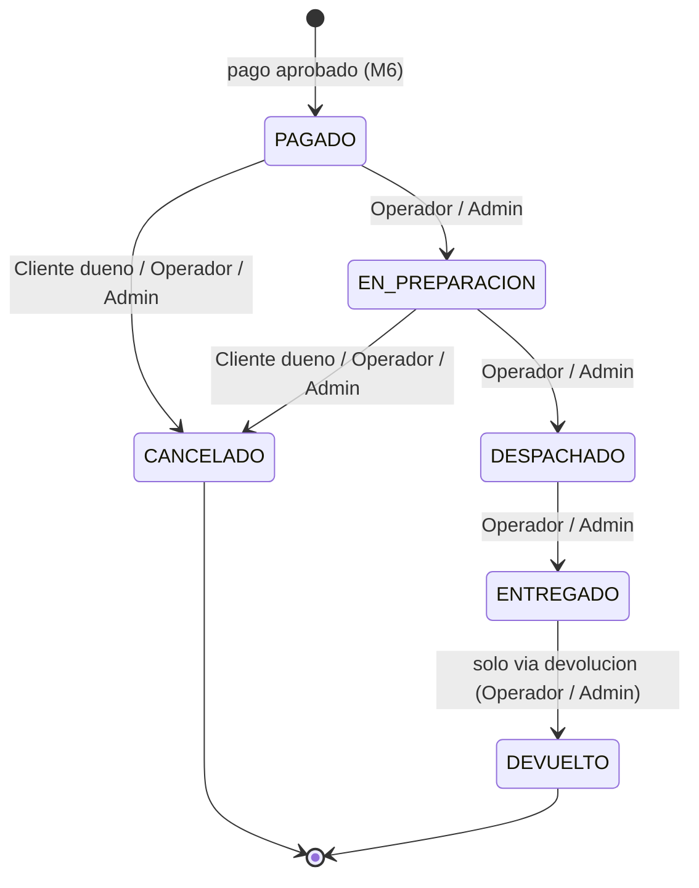

# ShopCart

Backend de e-commerce para las gasolineras y tienda de conveniencia "Don Arturo /
RinoMart". Monorepo: la base de datos en `db/` y la API en `api/`.

## Descripcion

ShopCart es una API REST respaldada por SQL Server en la que **toda la logica de datos
vive en stored procedures** (el backend nunca arma SQL). Esta entrega corresponde a la
**Fase 1** y cubre los requisitos funcionales RF-01 a RF-09:

| RF | Modulo | Resumen |
|----|--------|---------|
| RF-01 | Autenticacion y usuarios | Registro/login con JWT, refresh tokens rotados, roles (Cliente/Operador/Administrador), direcciones. |
| RF-02 | Catalogo | Categorias, productos, variantes (SKU/precio) con atributos e imagenes. |
| RF-03 | Inventario y kardex | Existencia por variante con kardex inmutable; un unico SP la modifica. |
| RF-04 | Carrito | Carrito de cliente o de invitado (token), totales e IVA. |
| RF-05 | Cupones | Porcentaje/monto, vigencia, limites y categoria; validar/aplicar al carrito. |
| RF-06 | Checkout y pago | Reserva de existencia, pago simulado idempotente, creacion de pedido. |
| RF-07 | Pedidos y devoluciones | Maquina de estados, cancelacion y devoluciones (parcial/total). |
| RF-08 | Dashboard y reportes | Ventas por periodo/categoria, top productos, carritos abandonados, comparativo, export a Excel. |
| RF-09 | Bitacora | Auditoria inmutable de cambios con el usuario responsable. |

Extras: rate limiting, cache de reportes con invalidacion por evento y exportacion a
Excel. La **Fase 2** (front-end web) queda fuera del alcance de esta entrega.

## Stack

- **SQL Server 2022** (requiere `DATETRUNC`, de 2022).
- **Node.js 24 LTS** + **TypeScript** en modo `strict` (sin ORM; acceso solo por SP).
- **Express 5** (HTTP), **mssql** (driver, `request.execute`), **zod** (validacion).
- **pino** / **pino-http** (logs), **bcryptjs** (hash de contrasena),
  **jsonwebtoken** (JWT), **express-rate-limit** (rate limiting), **exceljs** (export).
- **helmet**, **cors**; documentacion **OpenAPI 3** via **swagger-ui-express**.

## Requisitos

- SQL Server 2022 (Developer/Express sirven).
- `sqlcmd` del cliente **ODBC 18** (o **go-sqlcmd**); el instalador usa `-C` (confia en
  el certificado) y `-b` (aborta al primer error).
- Node.js **24 LTS** y npm.
- Opcional, para las pruebas de API: Postman o **newman** (`npx newman`).

## Instalacion

### 1. Clonar el repositorio

```bash
git clone <url-del-repo> shopcart
cd shopcart
```

### 2. Base de datos (un comando)

Desde `db/`, el instalador aplica los scripts en el unico orden canonico valido y
verifica el resultado (ver `db/README.md`):

```powershell
cd db
.\aplicar.ps1                         # autenticacion de Windows contra localhost, con semillas
# o:  .\aplicar.ps1 -Server "localhost\SQLEXPRESS"
# o:  .\aplicar.ps1 -User sa -Password '<pass>' -IncluirSemillas:$false
```

Equivalente en bash: `./aplicar.sh` (mismas opciones). Al terminar imprime los conteos
de verificacion (26 tablas, procedimientos, triggers, vistas y el login `shopcart_app`).

### 3. API

```bash
cd api
npm ci                      # instala dependencias exactas del package-lock
cp .env.example .env        # y edite .env (ver "Variables de entorno")
npm run dev                 # desarrollo con recarga (tsx watch)
```

Variables minimas que hay que completar en `.env`: `DB_SERVER`, `DB_NAME`, `DB_USER`,
`DB_PASSWORD`, `JWT_ACCESS_SECRET` y `JWT_REFRESH_SECRET` (>= 32 caracteres). El resto
tiene default (ver tabla). Otros scripts: `npm run build` (compila a `dist/`),
`npm start` (corre la build), `npm run lint`, `npm run format`.

La API queda en `http://localhost:3000` (segun `PORT`). Verificacion:

- `GET /health` — estado del servicio y de la BD.
- `GET /api-docs` — documentacion Swagger (OpenAPI 3).
- **Todo el resto de la API vive bajo `http://localhost:3000/api/v1`** (auth, usuarios,
  catalogo, inventario, carrito, cupones, checkout, pedidos, bitacora, reportes).

### Instalacion para evaluacion

Para correr la coleccion de Postman/newman completa de una pasada sin topar los limites,
arranque con:

```bash
NODE_ENV=development PAGO_SIMULADO=true \
RATE_LIMIT_AUTH_MAX=100 RATE_LIMIT_CHECKOUT_MAX=100 RATE_LIMIT_CUPON_MAX=100 \
npm run dev
```

### Produccion

Diferencias respecto a desarrollo: `NODE_ENV=production`, `PAGO_SIMULADO=false`
(obligatorio: la app no arranca con pago simulado en produccion), `TRUST_PROXY` igual al
numero de proxies propios delante de la API, secretos JWT y contrasena de BD fuertes y
**rotados** fuera del control de versiones, y los limites de rate limit en sus valores
reales (no 100). El archivo de semillas `099` no se aplica en produccion.

## Variables de entorno

Se definen en `api/.env` (plantilla en `api/.env.example`). La aplicacion valida
estas variables al arrancar con zod y **no inicia** si falta alguna o es invalida.

Esta tabla refleja 1:1 las claves que valida `api/src/config/env.ts` (y `api/.env.example`).
"Obligatoria" = sin valor por defecto (la app no arranca si falta).

| Variable | Descripcion | Default | Obligatoria |
|----------|-------------|---------|:-----------:|
| `NODE_ENV` | Entorno de ejecucion (`development`/`test`/`production`) | `development` | No |
| `PORT` | Puerto HTTP de la API | `3000` | No |
| `DB_SERVER` | Host/instancia de SQL Server | — | **Si** |
| `DB_PORT` | Puerto de SQL Server | `1433` | No |
| `DB_NAME` | Nombre de la base de datos | — | **Si** |
| `DB_USER` | Usuario de SQL Server | — | **Si** |
| `DB_PASSWORD` | Contrasena de SQL Server | — | **Si** |
| `DB_ENCRYPT` | Cifrar la conexion (`true`/`false`) | `true` | No |
| `DB_TRUST_SERVER_CERT` | Confiar en el certificado del servidor | `false` | No |
| `DB_REQUEST_TIMEOUT_MS` | Timeout de cada request a SQL Server (ms) | `30000` | No |
| `CORS_ORIGIN` | Origenes permitidos (separados por coma) | — | **Si** |
| `JWT_ACCESS_SECRET` | Secreto del access token (min. 32 chars) | — | **Si** |
| `JWT_REFRESH_SECRET` | Secreto del refresh token (min. 32 chars) | — | **Si** |
| `JWT_ACCESS_EXPIRES` | Vigencia del access token | `15m` | No |
| `JWT_REFRESH_EXPIRES` | Vigencia del refresh token | `7d` | No |
| `RESERVA_JOB_SEGUNDOS` | Intervalo del job que libera reservas vencidas (s) | `60` | No |
| `LOG_LEVEL` | Nivel de log de pino (`trace`..`fatal`, `silent`) | `info` | No |
| `REPORTES_CACHE_TTL_SEGUNDOS` | Vigencia del cache de reportes (RF-08); `0` lo desactiva | `60` | No |
| `RATE_LIMIT_AUTH_MAX` | Intentos a `/auth/*` por IP por ventana | `10` | No |
| `RATE_LIMIT_AUTH_VENTANA_MIN` | Ventana del rate limit de auth (min) | `15` | No |
| `RATE_LIMIT_CHECKOUT_MAX` | Operaciones de checkout por usuario por minuto | `20` | No |
| `RATE_LIMIT_CUPON_MAX` | Aplicaciones de cupon por identidad por minuto | `10` | No |
| `TRUST_PROXY` | Saltos de proxy de confianza para derivar la IP (Express `trust proxy`); `0` = sin proxy | `0` | No |
| `PAGO_SIMULADO` | Pago simulado (solo desarrollo/demo); `false` obligatorio en produccion | `false` | No |

> La configuracion de **negocio** (minutos de reserva, horas de abandono de carrito,
> porcentaje de IVA, stock minimo, costo de envio) NO esta en `.env`: vive en la tabla
> `dbo.Parametro` y la leen los stored procedures.

## Scripts de base de datos

Se aplican con `db/aplicar.ps1` (o `aplicar.sh`) en el **orden canonico unico** definido
en ese instalador; el detalle, la idempotencia y el equivalente manual estan en
[`db/README.md`](db/README.md). Resumen:

| Script | Descripcion |
|--------|-------------|
| `001_CreateDatabase.sql` | Base de datos `ShopCart` y modelo relacional (26 tablas). |
| `002_SP_Sistema_Ping.sql` | `dbo.SP_Sistema_Ping` para `/health`. |
| `003_Security.sql` | Login `shopcart_app` (solo `EXECUTE`) y bitacora inmutable. |
| `004_Catalogos.sql` | Roles, tipos de movimiento de inventario, parametros, indice de usuarios. |
| `005_SP_Auth.sql` | SPs de autenticacion (registro, login, refresh tokens). |
| `006_SP_Usuarios.sql` | SPs de gestion de usuarios (Administrador). |
| `007_SP_Direcciones.sql` | SPs de direcciones del usuario. |
| `008_VW_Inventario.sql` | Vista de inventario disponible, indice de busqueda y TVP de atributos. |
| `009_SP_Categorias.sql` | SPs de categorias del catalogo (RF-02). |
| `010_SP_Catalogo.sql` | SPs de productos, variantes e imagenes (RF-02). |
| `011_SP_Inventario.sql` | SPs de inventario y kardex (RF-03). |
| `012_SP_Carrito.sql` | Funcion de totales y SPs del carrito de compras (RF-04). En M5 la funcion de totales pasa a descontar el cupon, por eso se reaplica despues de `014`. |
| `013_Migracion_CarritoCupon.sql` | Migracion posterior al `001`: agrega `Carrito.IDCupon` y su FK para recordar el cupon aplicado antes del checkout (RF-05). |
| `014_SP_Cupones.sql` | Funciones (`FU_Cupones_CalculoDescuento`, `FU_Cupones_Estado`) y SPs de cupones: validar/aplicar/quitar y CRUD de administracion (RF-05). |
| `015_Catalogo_EstadosPedido.sql` | Estados de pedido y transiciones permitidas; base del ciclo de vida (RF-06, RF-07). Idempotente. |
| `016_SP_Checkout.sql` | Reserva de existencia, checkout en dos pasos, pago simulado idempotente y creacion de pedido (RF-06): `SP_Inventario_ReservarExistencia`, `SP_Checkout_Iniciar`/`_Resumen`, `SP_Pedidos_CrearPedido`, `SP_Checkout_LiberarReservasVencidas`. |
| `017_Migracion_CarritoTokenUnico.sql` | Migracion posterior al `001`: cambia la unicidad del token de invitado a un indice unico filtrado para tolerar multiples NULL (RF-06). |
| `018_SP_Pedidos.sql` | Pedidos (RF-07): ciclo de vida (`SP_Pedidos_CambiarEstado`), devoluciones (`SP_Pedidos_RegistrarDevolucion` con `TVP_DevolucionLinea`), consulta (`SP_Pedidos_Obtener`), listado (`SP_Pedidos_Listar`) y el trigger `TR_Pedido_TransicionValida`. |
| `019_Bitacora.sql` | Bitacora de auditoria (RF-09): triggers set-based que registran altas/cambios/bajas de productos, variantes, kardex, cupones y estados de pedido (`TR_Producto_Bitacora`, `TR_Variante_Bitacora`, `TR_Kardex_Bitacora`, `TR_Cupon_Bitacora`, `TR_PedidoHistorialEstado_Bitacora`), la consulta (`SP_Bitacora_Consultar`), los modulos (`SP_Bitacora_Modulos`) y el helper `SP_Bitacora_Registrar`. |
| `020_Reportes.sql` | Dashboard y reportes (RF-08): vistas `VW_Reportes_PedidoNeto` y `VW_Reportes_LineaNeta` (venta neta de devoluciones) y SPs `SP_Reportes_VentasPorPeriodo` (DIA/SEMANA/MES con `DATETRUNC`), `SP_Reportes_VentasPorCategoria`, `SP_Reportes_TopProductos`, `SP_Reportes_CarritosAbandonados` y `SP_Reportes_Resumen` (con comparativo del periodo anterior); indice de apoyo `IX_Devolucion_Pedido_Monto`. |
| `099_Semillas.sql` | Datos de ejemplo: usuarios/direccion (M1), catalogo (M2), carga de inventario (M3), carritos (M4), cupones (M5) y ~12 pedidos de demostracion con fechas repartidas (M6-M9). Se aplica al final. |

## Decisiones tecnicas

**Configuracion: negocio en BD, tecnica en env.** La configuracion de **negocio**
(minutos de reserva, horas de abandono de carrito, porcentaje de IVA, stock minimo,
costo de envio, etc.) vive en la tabla `dbo.Parametro` y la leen los stored procedures;
asi se ajusta sin redesplegar la API. La configuracion **tecnica** (conexion, secretos
JWT, niveles de log, TTL de cache, limites de rate limit, `TRUST_PROXY`) vive en
variables de entorno validadas por zod en `api/src/config/env.ts`, unico modulo que lee
`process.env`.

**Login con respuesta uniforme (anti-enumeracion).** `POST /auth/login` responde
SIEMPRE `401 'Credenciales invalidas'` ante usuario inexistente, contrasena incorrecta,
cuenta bloqueada o desactivada; la causa real solo va a `logger.warn` (con `requestId` y
el correo enmascarado, nunca la contrasena). Se mantiene una comparacion bcrypt dummy y
se hace la comparacion antes de los chequeos de estado para igualar los tiempos de
respuesta, de modo que un atacante no distingue que cuentas existen o estan bloqueadas.

**Ventana del access token (15 min).** El rol viaja dentro del access token (JWT,
`JWT_ACCESS_EXPIRES=15m`). Al cambiar el rol o desactivar un usuario, los SPs de M1
revocan sus refresh tokens activos para forzar re-login; el access token ya emitido
sigue valido hasta 15 min. Es una decision documentada: se acepta esa ventana a cambio
de no mantener una lista de revocacion de access tokens.

**Confianza en el proxy.** `app.set('trust proxy', TRUST_PROXY)`: con `0` (default) la IP
es la del socket; detras de un proxy/balanceador propio se fija al numero de saltos para
que `req.ip` (y por tanto el rate limiting por IP) use el `X-Forwarded-For` correcto.

**Acceso a datos exclusivo por stored procedures.** El backend nunca arma SQL.
El unico punto de acceso es `executeSp(spName, params)` (`api/src/data/spExecutor.ts`),
que ejecuta `request.execute(spName)` con parametros tipados (`request.input`/
`request.output`). No existe `batch()`, `query()` ni cadenas con comandos SQL en
el codigo TypeScript. `assertIdentifier` valida el nombre del SP y de los
parametros como defensa adicional, aunque siempre provienen del codigo.

**Auditoria de bitacora via session context.** Todo SP que **escribe** datos
recibe `@IDUsuarioEjecuta INT` como un parametro tipado mas (puede ser `NULL`
solo en el registro de clientes, donde aun no hay actor) y, como primera
instruccion, publica ese valor en el contexto de sesion:

```sql
EXEC sys.sp_set_session_context @key = N'IDUsuario', @value = @IDUsuarioEjecuta;
```

Los triggers de bitacora leen el autor con `SESSION_CONTEXT(N'IDUsuario')`. El
backend **no** fija el contexto de sesion por su cuenta: solo pasa
`@IDUsuarioEjecuta` dentro de `params`, como cualquier otro parametro del SP.

**Bitacora inmutable.** `dbo.Bitacora` es append-only. Ver
[Credenciales de prueba](#credenciales-de-prueba) y `db/scripts/003_Security.sql`:
el usuario de aplicacion solo tiene `EXECUTE` sobre `dbo` (sin permisos de tabla),
y un trigger `INSTEAD OF UPDATE, DELETE` bloquea cualquier modificacion o borrado,
incluso desde `dbo` o un SP.

### Decisiones de seguridad

Un resumen del modelo de amenazas y las decisiones que lo sostienen (los detalles
tecnicos estan en las notas de arriba y en cada modulo).

- **Sesion por JWT en el header, no en cookies.** El access token viaja en
  `Authorization: Bearer` y el front lo guarda del lado del cliente; al no usar cookies
  de sesion, **CSRF no aplica** (no hay credencial que el navegador adjunte sola) y por
  eso no se incluye proteccion anti-CSRF.
- **Ventana de 15 minutos del access token.** El rol viaja firmado dentro del token. Al
  hacer logout, desactivar un usuario o cambiarle el rol se revocan sus refresh tokens
  (no podra renovar), pero el access token ya emitido sigue valido hasta 15 min. Se
  acepta esa ventana a proposito: evita mantener una lista de revocacion de access
  tokens consultada en cada request, a cambio de una exposicion corta y acotada.
- **Lockout en dos capas.** Capa 1, en memoria por `(correo + IP)`: tras 5 fallos en 15
  min desde la misma IP para el mismo correo se rechaza sin tocar la BD. Capa 2, por
  cuenta en BD (`Usuario.IntentosFallidos`, umbral `LOGIN_MAX_INTENTOS = 10`). La capa 1
  frena la fuerza bruta desde una IP **sin** permitir que un atacante bloquee la cuenta
  de un tercero (el bloqueo por IP+correo no afecta a otras IPs). Un login exitoso limpia
  ambas.
- **Rate limiting por recurso y por identidad justa.** `/auth/*` por IP; checkout por
  usuario; aplicacion/validacion de cupones por identidad (usuario o token de invitado).
  La clave es la identidad, no solo la IP, para no castigar a varios clientes tras un NAT.
- **Respuestas uniformes.** El login responde siempre `401 'Credenciales invalidas'`
  (no distingue inexistente / mala contrasena / bloqueado / desactivado) y el acceso a
  una direccion ajena responde `404` igual que una inexistente: no se filtra la
  existencia de cuentas ni de recursos. La causa real queda en el log.
- **Sin recuperacion de contrasena en Fase 1.** Queda fuera de alcance; cuando se
  implemente llevara su propio rate limit por correo y por IP y un token de un solo uso
  con expiracion corta.
- **Cabeceras de seguridad.** `helmet` (con `Cross-Origin-Resource-Policy: same-origin`)
  mas `Permissions-Policy: camera=(), microphone=(), geolocation=()` fijada a mano
  (helmet 8 no la trae). CORS restringe los origenes a `CORS_ORIGIN`.
- **Validacion de entrada con lista blanca.** Los campos de texto que se muestran o
  exportan (nombres, alias, direccion, motivos) pasan por `textoPlano`, que rechaza
  caracteres de control y `< >` (anti-inyeccion de markup y de formulas en el `.xlsx`,
  junto con el prefijo de apostrofo del export). Las descripciones largas solo filtran
  caracteres de control.
- **Acceso a datos solo por stored procedures** (sin SQL en el backend) y **bitacora
  inmutable** en tres capas (ver arriba).
- **Credenciales de evaluacion.** Las contrasenas sembradas y la de BD son publicas y
  de desarrollo; en produccion no se aplica el seed y se rotan (ver
  [Credenciales de prueba](#credenciales-de-prueba)).

### Autenticacion y usuarios (M1, RF-01)

- **Hash de contrasenas con `bcryptjs`** (cost 10): implementacion en JS puro, sin
  binarios nativos, para garantizar portabilidad en una maquina limpia (no depende
  de `node-gyp` ni toolchain de compilacion).
- **Refresh token en el cuerpo JSON, no en cookie.** Trade-off deliberado: el
  frontend del reto es una SPA que guarda el token y lo envia explicitamente; evita
  la complejidad de CSRF y de la configuracion de cookies cross-site. El costo es
  que el almacenamiento seguro del refresh queda a cargo del cliente.
- **Rotacion con deteccion de reutilizacion.** Cada refresh se guarda como hash
  SHA-256 (`CHAR(64)`). Al rotar, si llega un token ya revocado se asume robo: se
  revoca **toda la cadena activa** del usuario y se rechaza (401).
- **Lockout de login:** 5 intentos fallidos bloquean la cuenta 15 minutos
  (parametros `LOGIN_MAX_INTENTOS` / `LOGIN_BLOQUEO_MINUTOS`).
- **403 en recursos ajenos verificado en el SP.** La pertenencia de una direccion
  se valida dentro del stored procedure con el `@IDUsuario` del token, no en el
  backend; una direccion de otro usuario responde 403.
- **Usuario desactivado** se rechaza en el login y en el refresh. El access token
  (15 min) no se revoca: simplemente expira solo.
- **Rate limiting** en `/auth/registro`, `/auth/login` y `/auth/refresh`
  (`express-rate-limit`, valores en `.env`); el exceso responde 429 con el mismo
  formato de error del resto de la API.
- **JWT access token** firmado con `JWT_ACCESS_SECRET`, payload
  `{ sub, rol, nombre }`; el middleware `authenticate` adjunta `req.usuario` y
  `authorize(...roles)` restringe por rol.

### Catalogo de productos (M2, RF-02)

- **SKU, precio y existencia pertenecen a la variante.** El producto no tiene
  SKU: agrupa variantes. Un producto sin variantes activas no es vendible ni
  visible en tienda.
- **Baja logica siempre** (`Activo = 0`) para categorias, productos y variantes,
  incluso con ventas asociadas: `PedidoDetalle` y el kardex referencian la
  variante, asi que un borrado fisico romperia el historial. `CambiarEstadoProducto`
  devuelve `TieneVentas` como dato informativo. Las imagenes si se borran
  fisicamente (no las referencia nada).
- **El catalogo nunca escribe `Variante.Existencia`.** La variante nace en 0 y la
  existencia solo cambia por kardex (M3). Ningun SP de M2 toca esa columna.
- **Visible en tienda** = `Producto.Activo = 1` AND `Categoria.Activo = 1` AND al
  menos una variante activa. Desactivar un producto no cambia el `Activo` de sus
  variantes.
- **Disponibilidad** via `VW_Inventario_Disponible`: `Disponible = Existencia -`
  reservas activas no vencidas.
- **Busqueda sin SQL dinamico.** Filtros opcionales con el patron
  `(@Param IS NULL OR columna = @Param)`, `LIKE` con `CONCAT(N'%', @Texto, N'%')`,
  orden por lista blanca con expresiones `CASE` (nunca columna interpolada) y
  `OPTION (RECOMPILE)` para que el plan se ajuste a los filtros efectivos.
- **TVP para atributos.** Los atributos de variante se envian como un parametro de
  tipo tabla `dbo.TVP_VarianteAtributo` (objeto `sql.Table` de mssql) en una sola
  llamada; cero SQL en TypeScript.
- **Imagenes solo por URL** (no se suben binarios). Una imagen principal por
  producto, garantizada dentro del SP en una transaccion.
- **Lectura del catalogo:** publica sin token (`/catalogo/...`, siempre
  `IncluirInactivos = 0`), o de administracion para Administrador y Operador
  (acepta `incluirInactivos`). La **escritura** es exclusiva del Administrador.
- **404 uniforme** para un producto inexistente o inactivo en la ruta publica: la
  misma respuesta en ambos casos, para no revelar el catalogo oculto.

### Inventario y kardex (M3, RF-03)

- **Un unico SP escribe la existencia.** `SP_Inventario_RegistrarMovimiento` es el
  unico lugar que hace `UPDATE` sobre `Variante.Existencia`; ningun otro SP de ningun
  modulo la toca. Checkout, cancelacion y devolucion llaman a este SP desde sus propios
  SPs (`@OrigenInterno = 1`), nunca con un update directo.
- **Invariante `Existencia = SUM(Signo * Cantidad)` del kardex.** Cada fila de `Kardex`
  guarda `ExistenciaResultante`. `SP_Inventario_VerificarConsistencia` audita el
  invariante y el endpoint `GET /inventario/consistencia` (Administrador) debe devolver
  cero inconsistencias.
- **Tipos reservados al sistema.** La API solo expone `ENTRADA_COMPRA`,
  `AJUSTE_POSITIVO` y `AJUSTE_NEGATIVO`. `SALIDA_VENTA`, `DEVOLUCION` y `CANCELACION`
  exigen `@OrigenInterno = 1`, que solo envian los SPs de pedidos; el backend nunca
  expone ni envia ese parametro (intentarlo desde la API responde 403).
- **Ajuste negativo mas estricto que el fisico.** Un movimiento negativo no puede dejar
  la existencia fisica < 0 **ni** el disponible (`existencia - reservas activas no
  vencidas`) < 0. Es mas estricto que exigir solo existencia >= 0: evita vender o retirar
  unidades ya comprometidas por reservas de carritos vigentes, que romperian un checkout
  en curso.
- **Concurrencia.** El movimiento lee la variante con `WITH (UPDLOCK, HOLDLOCK)` dentro
  de la transaccion (aislamiento READ COMMITTED por defecto), serializando los
  movimientos concurrentes sobre la misma variante y evitando condiciones de carrera al
  recalcular la existencia.
- **Kardex inmutable de hecho:** solo hay `INSERT` sobre `Kardex`; ningun SP hace
  `UPDATE`/`DELETE` de movimientos. La correccion de un error se hace con un ajuste
  compensatorio, no editando el historial.
- **`STOCK_MINIMO`** vive en `dbo.Parametro` (= 5); el listado de existencias marca
  `BajoStock` cuando `Disponible <= STOCK_MINIMO` y acepta `soloBajoStock=true`.
- **Semillas via el SP.** La carga inicial de inventario (`099`) recorre las variantes
  activas sin kardex y llama a `SP_Inventario_RegistrarMovimiento` (ENTRADA_COMPRA);
  nunca hace `UPDATE` directo, de modo que la existencia sembrada tambien respeta el
  invariante.

### Carrito de compras (M4, RF-04)

- **El carrito no lleva ID en la URL.** Se identifica SIEMPRE por la identidad: el
  cliente autenticado usa su carrito `Activo` (se crea si no existe); el invitado usa
  el header `X-Cart-Token` (UUID). El middleware `cartIdentity` resuelve `req.carrito`
  y nunca se acepta un ID de carrito del cliente. Rutas: `GET /carrito`,
  `POST /carrito/items`, `PUT/DELETE /carrito/items/:idVariante`, `DELETE /carrito`.
- **Invitado por token UUID.** Si un invitado no envia header, el primer
  `POST /carrito/items` crea el carrito y la API devuelve el token en el header
  `X-Cart-Token` y en el cuerpo (`cartToken`). `GET /carrito` sin identidad ni header
  responde 200 con un carrito vacio sin crear nada.
- **Solo el servidor acuna tokens.** Un cliente no puede inventar un `X-Cart-Token`
  para materializar un carrito: el carrito de invitado se crea unicamente cuando el
  backend genera el UUID (`randomUUID`) en el primer `POST /carrito/items` sin header.
  `SP_Carrito_AgregarItem` recibe `@CrearSiNoExiste` y el servicio lo envia en 1 solo
  en ese caso; con un token desconocido las escrituras (`POST`/`PUT`/`DELETE` de item y
  `DELETE /carrito`) responden **404 `Carrito no encontrado`**. `GET /carrito` con un
  token desconocido sigue respondiendo 200 con el carrito vacio (sin error), para no
  filtrar la existencia de carritos.
- **Operador y Administrador no tienen carrito.** Cualquier ruta de `/carrito`
  responde 403 para esos roles; el carrito es exclusivo del rol Cliente. Si llegan
  Bearer de Cliente y `X-Cart-Token` a la vez, se ignora el header (manda la identidad).
- **Fusion en login/registro.** `POST /auth/login` y `POST /auth/registro` aceptan el
  header opcional `X-Cart-Token`; tras autenticar, el servicio llama a
  `SP_Carrito_Fusionar`. Si el token no existe o su carrito no esta `Activo`, no es
  error (se ignora). Las lineas del invitado se suman al carrito del usuario (creandolo
  si no existe) **topando cada cantidad al disponible**; el carrito invitado queda
  `Convertido`. La respuesta incluye `carritoFusionado: { lineas, advertencias }` o
  `null`.
- **Validacion suave de disponible; la reserva es del checkout.** El carrito nunca
  reserva existencia ni toca `Variante.Existencia`, `Kardex` ni `Reserva`: solo valida
  que la cantidad de la linea sea `<= Disponible` (`Existencia - reservas activas no
  vencidas`) en el momento de agregar/modificar. La reserva real ocurre en el checkout
  (M6). Por eso `GET /carrito` marca cada linea con `Advertencia` (sin existencia o no
  disponible) en vez de rechazarla: el disponible pudo cambiar despues de agregarla.
- **Regla de bloqueo heredada de M3.** Todo SP que lee el disponible para decidir una
  escritura bloquea primero la fila de `dbo.Variante` con `WITH (UPDLOCK, HOLDLOCK)`
  dentro de la transaccion y despues consulta `Reserva`. La fusion bloquea las variantes
  en orden de `IDVariante` para evitar deadlocks.
- **Totales y desglose de IVA en SQL con `DECIMAL(18,2)`.** `FU_Carrito_CalcularTotales`
  (funcion en linea, invocada solo desde SPs) calcula `TotalLinea = ROUND(Precio *
  Cantidad, 2)`, `Subtotal`, `Total = Subtotal - Descuento`, y el IVA incluido en el
  precio: `BaseImponible = ROUND(Total / (1 + IVA/100), 2)`, `IVA = Total -
  BaseImponible`. El `PorcentajeIVA` sale del parametro de IVA en `dbo.Parametro` (default 12).
  El backend nunca calcula montos.
- **Descuento = 0 en M4.** `Descuento` siempre es `0.00`; la funcion lo deja marcado
  para que **M5 (cupones)** lo sustituya. El cupon del carrito se resuelve en M5 con un
  script de migracion (no se agregaron columnas en M4).
- **Precio vigente en el carrito, congelado en el pedido.** Las lineas usan
  `Variante.Precio` actual; el precio se congela recien al crear el pedido (M6).
- **Limites.** Cantidad por linea entre 1 y 1000; maximo 50 lineas por carrito (la
  linea 51 responde 422). `PUT` fija la cantidad (no suma); `POST` suma a la existente.
- **Abandono como estado derivado (M9).** Cada escritura actualiza
  `FechaUltimaActividad`; el estado `Abandonado` lo derivara un proceso de M9. En las
  semillas el carrito de invitado nace con la fecha retrasada 3 dias (unico lugar donde
  se toca esa fecha a mano, y solo para datos de prueba).

### Cupones y promociones (M5, RF-05)

- **Migracion 013, no cambios en el 001.** El modelo base no se toca. `Carrito.IDCupon`
  (nullable, con FK a `Cupon`) se agrega en `013_Migracion_CarritoCupon.sql` para que el
  carrito recuerde el cupon aplicado **antes** del checkout. La migracion es idempotente
  (`COL_LENGTH` / `sys.foreign_keys`) y usa `GO` para que la columna exista antes de
  referenciarla. Orden de aplicacion de M5: **013 -> 014 -> 012 (se reaplica) -> 099**,
  porque `FU_Carrito_CalcularTotales` (012) depende de las funciones de cupon (014) y de
  la columna (013): una funcion en linea exige que lo referenciado exista al crearse.
- **Aplicar no es consumir.** M5 solo **valida y guarda** `Carrito.IDCupon`; nunca toca
  `Cupon.UsosActuales` ni inserta en `CuponUso`. El **consumo** de un uso es del checkout
  (M6): dentro de su transaccion, con `UPDATE Cupon SET UsosActuales = UsosActuales + 1
  WHERE ... AND (LimiteUsosTotal IS NULL OR UsosActuales < LimiteUsosTotal)` validando
  `@@ROWCOUNT`, con el `CHECK` de tabla como ultima defensa. Orden de bloqueo del
  checkout: `Carrito` -> `Variante` -> `Reserva` -> `Cupon`.
- **Cupones solo con sesion.** Son exclusivos del Cliente autenticado. En
  `POST`/`DELETE /carrito/cupon` el controlador exige `req.carrito.idUsuario`; un invitado
  recibe **401 `Inicie sesion para aplicar cupones`** antes de tocar la base.
- **Base elegible y formulas.** La base elegible es el subtotal de las lineas cuya
  `Producto.IDCategoria` coincide con `Cupon.IDCategoria` (si el cupon tiene categoria) o
  el subtotal completo. `PORCENTAJE -> ROUND(base * Valor / 100, 2)`; `MONTO -> el menor
  entre Valor y base`. El descuento nunca supera el `Subtotal`. Todo en `DECIMAL(18,2)` y
  calculado en SQL (`FU_Cupones_CalculoDescuento`); el backend no calcula montos.
- **Monto minimo contra el subtotal.** El `MontoMinimo` se compara contra el `Subtotal`
  completo del carrito (no contra la base elegible).
- **Validez en orden con mensaje propio.** `FU_Cupones_Estado` evalua y devuelve la
  primera causa que falla: (1) no existe o inactivo -> **404 `Cupon invalido`**; (2) aun
  no vigente, (3) vencido, (4) agotado, (5) limite por cliente alcanzado, (6) no alcanza
  el monto minimo (`... de Q X (faltan Q Y)`), (7) con categoria y base elegible 0 -> todas
  **422**. El codigo se normaliza con `UPPER(TRIM(...))`.
- **Re-validacion al mostrar.** `GET /carrito` recalcula el cupon guardado: si ya no
  cumple 1-7, `Descuento = 0` y el objeto `cupon.descuento` informa `valido: false` y la
  `causa`; **no** lanza error. `FU_Carrito_CalcularTotales` solo descuenta cuando el cupon
  sigue siendo valido.
- **Un cupon por carrito.** Aplicar uno reemplaza el anterior (`UPDATE Carrito SET
  IDCupon`). `DELETE /carrito/cupon` lo quita (sin error si no habia). Vaciar el carrito
  (`DELETE /carrito`) tambien quita el cupon: `SP_Carrito_Vaciar` pone `IDCupon = NULL`
  porque un carrito vacio no conserva cupon.
- **Cupon con usos congelado.** Un cupon con usos (`CuponUso` o `UsosActuales > 0`) no
  puede cambiar `Codigo`, `TipoDescuento`, `Valor` ni `IDCategoria` (**409**); si solo
  cambian fechas o limites, se permite. `SP_Cupones_Actualizar` nunca escribe
  `UsosActuales`.
- **Respuesta del carrito.** El servicio arma `cupon` desde el tercer recordset de
  `SP_Carrito_Obtener` como `{ IDCupon, Codigo, TipoDescuento, Valor, Categoria, descuento:
  { baseElegible, descuento, valido, causa } }` (o `null`). El `Descuento` del cupon ya
  esta reflejado en `carrito.totales`.

### Checkout y pago (M6, RF-06)

- **Dos pasos: reservar y luego pagar.** `POST /checkout/iniciar` **reserva** existencia
  por los minutos de reserva configurados en `dbo.Parametro` (default 15) y devuelve un resumen con totales y costo
  de envio; `POST /checkout/pagar` **cobra** (pago simulado) y, si aprueba, crea el pedido.
  Separar reserva de pago evita vender mas unidades de las que hay cuando varios clientes
  compiten por el ultimo stock.
- **Iniciar es reiniciable.** Vuelve a reservar: libera las reservas `Activa` del propio
  carrito y crea nuevas. Reintentar el checkout nunca acumula reservas duplicadas.
- **Pagar exige reserva vigente.** `SP_Pedidos_CrearPedido` verifica que **todas** las
  lineas tengan `Reserva` `Activa`, `FechaExpira > ahora` y la misma cantidad; si no,
  **409 `La reserva vencio o no existe; inicie el checkout de nuevo`**. Asi la reserva es
  el "boleto" que garantiza el stock entre los dos pasos.
- **Idempotencia en la base.** El header `Idempotency-Key` (16-100, `[A-Za-z0-9_-]`) se
  guarda como `Pago.ClaveIdempotencia` con `UNIQUE`. El SP bloquea el carrito
  (`UPDLOCK, HOLDLOCK`) y busca el pago por clave **dentro** del lock: si ya existe y es del
  mismo usuario, hace **replay** y devuelve exactamente el mismo resultado (sin tocar nada);
  si es de otro usuario, **409 `Clave de idempotencia en uso`**. El `UNIQUE` es la ultima
  defensa ante una carrera. Dos `pagar` con la misma clave devuelven el mismo
  `NumeroPedido` y el mismo codigo HTTP; uno trae `replay: true`.
- **Pago simulado y 402.** `simularResultado` (`APROBADO` por defecto) decide el desenlace.
  Aprobado responde **201** (se creo el pedido); rechazado responde **402 Payment
  Required** (semantica HTTP del pago que no prospera), registra el `Pago` `Rechazado`,
  **no** crea pedido y **deja las reservas intactas** para poder reintentar. En replay se
  repite el mismo codigo (201 o 402), deducido de `aprobado`.
- **Orden exacto de la transaccion aprobada.** (0) **pre-bloquear** las variantes del
  carrito en `IDVariante` ascendente (recorriendo `CarritoDetalle`, antes de leer totales y
  de construir `#Lineas`), (1) leer totales y armar el snapshot (`#Lineas` con prorrateo),
  (2) consumir reservas (`Estado = 'Consumida'`, solo vigentes; si el numero de reservas
  consumidas no iguala las lineas del carrito -> `409`), (3) crear `Pedido`, (4)
  `PedidoDetalle`, (5) un `SP_Inventario_RegistrarMovimiento` `SALIDA_VENTA` por linea, (6)
  uso del cupon, (7) `Pago` aprobado, (8) `Carrito` `Convertido`, (9) historial de estado.
  **Las reservas se consumen ANTES del kardex** porque `SP_Inventario_RegistrarMovimiento`
  descuenta del disponible las reservas activas; si siguieran `Activa`, la salida de venta
  de la misma cantidad se bloquearia a si misma.
- **Orden de bloqueo anti-deadlock.** `Carrito (UPDLOCK, HOLDLOCK)` -> `Variante
  (UPDLOCK, HOLDLOCK, IDVariante ascendente)` -> `Reserva` -> `Cupon (UPDLOCK)`. En la rama
  aprobada se **pre-bloquean** primero todas las variantes del carrito en `IDVariante`
  ascendente (un `SELECT ... WITH (UPDLOCK, HOLDLOCK)` por cada una) y solo despues se
  consumen las reservas y se registra el kardex. El pre-bloqueo es necesario: sin el, entre
  consumir la reserva (que la quita del disponible) y registrar la salida de venta, otro
  carrito podria reservar esa unidad y el pago fallaria. Con el, el orden se cumple de forma
  literal y las variantes quedan retenidas hasta el `COMMIT`.
- **SPs anidados.** `SP_Inventario_RegistrarMovimiento` abre su propio `BEGIN TRAN/COMMIT`
  dentro de la transaccion de `CrearPedido` (el commit interno solo decrementa
  `@@TRANCOUNT`). Un `THROW` interno ya hizo `ROLLBACK` de todo y relanza; el `CATCH`
  exterior encuentra `@@TRANCOUNT = 0` y solo relanza. Se le pasa `@SinResultado = 1` para
  que **no** devuelva un result set por cada movimiento y asi no contaminar la salida.
- **Snapshot y prorrateo del descuento.** El pedido guarda un snapshot inmutable: `SKU`,
  `NombreProducto`, `DescripcionVariante` (`STRING_AGG` de los atributos), `IDCategoria`,
  `PrecioUnitario` y el `DescuentoLinea` **prorrateado**. Por linea elegible,
  `DescuentoLinea = ROUND(Descuento * TotalLineaBruta / BaseElegible, 2)`; la ultima linea
  elegible (mayor `IDVariante`) absorbe el redondeo para que `SUM(DescuentoLinea) =
  Descuento` al centavo; las no elegibles van en 0. `TotalLinea = bruto - DescuentoLinea`.
- **Numero de pedido legible.** `NumeroPedido = 'SC-' + FORMAT(NEXT VALUE FOR
  SEQ_Pedido_Numero, '000000')` (p.ej. `SC-000001`), con `UNIQUE`.
- **IVA sobre el total con envio.** El costo de envio **grava IVA**: la base imponible y el
  IVA se calculan sobre el total **con** envio, no sobre el del carrito. La formula es
  `BaseImponible = ROUND(Total / (1 + IVA/100), 2)` e `IVA = Total - BaseImponible`, con
  `Total = Subtotal - Descuento + CostoEnvio`. `FU_Carrito_CalcularTotales` (012) **no**
  cambia (es del carrito, sin envio); por eso `SP_Checkout_Iniciar` y `SP_Checkout_Resumen`
  recalculan `BaseImponible`/`IVA` sobre `TotalConEnvio` con esa misma formula (no usan los
  de la funcion). `SP_Pedidos_CrearPedido` ya persiste el pedido con esta regla.
- **Estados y ciclo de vida.** `015` siembra `EstadoPedido` y `TransicionEstadoPedido`.
  El pedido nace en `PAGADO`; el grafo de transiciones y los roles estan en
  [Ciclo de vida del pedido](#ciclo-de-vida-del-pedido).
- **Liberacion de reservas por job + consulta.** `SP_Checkout_LiberarReservasVencidas`
  marca `Liberada` toda reserva `Activa` vencida (sin `session context`: actor nulo). El
  job `jobs/liberarReservas.ts` lo llama cada `RESERVA_JOB_SEGUNDOS` (default 60), loguea
  solo si libero algo y nunca tumba el proceso (errores capturados); arranca tras escuchar
  y se detiene en el apagado. Una bandera `enEjecucion` evita el solapamiento: si una
  corrida sigue viva (base lenta), la siguiente se salta ese ciclo y lo registra. El Administrador puede dispararlo a mano con
  `POST /checkout/reservas/liberar`. El disponible se lee en vivo de
  `VW_Inventario_Disponible` (existencia - reservas activas no vencidas).
- **Prueba de concurrencia.** `api/tests/concurrencia.mjs` (Node 24 puro, solo HTTP) crea
  una variante con **1 unidad**, registra 10 clientes que compiten y verifica: 10
  `iniciar` en paralelo -> **1x201 / 9x409**; dos `pagar` del ganador con la misma clave ->
  ambos **201**, mismo `NumeroPedido`, uno con `replay`; `GET /inventario/consistencia` ->
  `consistente: true`; un perdedor reintenta -> **409**; un pago **RECHAZADO** -> **402** con
  monto numerico y reintento **APROBADO** -> **201**; cliente B reutiliza la clave de A ->
  **409** sin `pedido`; y tras el pedido la variante en contienda queda en `Existencia=0`,
  `Reservado=0`. Se corre con la API arriba:
  `BASE_URL=http://localhost:3000 npm run test:concurrencia` (sale con codigo 1 si algun
  escenario falla). Registra 10 clientes + login admin, asi que conviene correr la API con
  `RATE_LIMIT_AUTH_MAX` alto (p.ej. 100); con el default (10) el limitador devuelve 429. El
  escenario de rechazo requiere `PAGO_SIMULADO=true`; cada usuario hace <=3 operaciones de
  checkout (por debajo de `RATE_LIMIT_CHECKOUT_MAX=20`), pero si se baja ese limite, correr
  con `RATE_LIMIT_CHECKOUT_MAX=100`.
- **Pago simulado gobernado por entorno.** `PAGO_SIMULADO` (default `false`) decide si el
  cliente puede elegir el desenlace. Con `false`, el backend **ignora** `simularResultado`
  del body y cobra siempre `APROBADO` (el body lo sigue aceptando para no romper Postman).
  Si `NODE_ENV=production` y `PAGO_SIMULADO=true`, la app **no arranca**. El resultado del
  pago siempre lo decide el servidor, nunca el cliente: al integrar una pasarela real, el SP
  recibira el resultado ya verificado por la pasarela.
- **Rate limiting del checkout.** `/checkout/iniciar` y `/checkout/pagar` se limitan por
  **usuario autenticado** (no por IP, para no castigar a varios clientes tras un mismo NAT),
  ventana de 1 minuto, maximo `RATE_LIMIT_CHECKOUT_MAX` (default 20). El exceso responde
  **429** con el formato de error estandar `{ code: 'RATE_LIMITED', message, requestId }`.

### Decisiones abiertas (M6)

- **Reinicio libre de `checkout/iniciar`.** Reiniciar el checkout vuelve a reservar sin
  limite de intentos. Se mitiga con **un solo carrito activo por usuario** (indice unico
  filtrado) y el **rate limit** del checkout. En produccion se anadiria un backoff por
  usuario y metricas de reservas creadas/liberadas para detectar abuso.
- **Clave de idempotencia unica global.** `Pago.ClaveIdempotencia` es `UNIQUE` en toda la
  tabla, no por usuario; por eso la clave de un usuario reusada por otro da **409** (y no un
  replay ajeno). Es lo mas seguro ante colisiones, a costa de que dos usuarios no puedan
  elegir la misma cadena. En produccion la clave la genera el cliente como UUID, asi que la
  colision entre usuarios es despreciable; si se quisiera aislar por usuario, la unicidad
  pasaria a `(IDUsuario, ClaveIdempotencia)`.
- **El replay no compara el cuerpo.** Un segundo `pagar` con la misma clave devuelve el
  resultado original **sin** verificar que el body coincida con el primero. Se asume que el
  cliente reintenta la MISMA peticion (semantica habitual de idempotencia). En produccion se
  guardaria un hash del cuerpo con la clave y se devolveria **422** si el reintento llega con
  un cuerpo distinto.
- **Correccion de modelo: unicidad del token de invitado.** En SQL Server un `UNIQUE`
  admite un solo NULL, asi que el `UQ_Carrito_TokenInvitado UNIQUE (TokenInvitado)` original
  dejaba crear un unico carrito de usuario (token NULL) y el segundo fallaba con error 2627.
  Corregido en la migracion `017` reemplazandolo por el indice unico filtrado
  `UX_Carrito_TokenInvitado ... WHERE TokenInvitado IS NOT NULL`: la unicidad aplica solo a
  tokens reales y los NULL quedan sin restringir (misma tecnica que `UX_Carrito_UsuarioActivo`).

### Pedidos y devoluciones (M7, RF-07)

Ciclo de vida del pedido gobernado por el grafo de `dbo.TransicionEstadoPedido` (`015`).
El grafo de estados y la tabla de transiciones/roles estan consolidados en
[Ciclo de vida del pedido](#ciclo-de-vida-del-pedido). Aqui se describe la mecanica:

- **Cancelacion.** Solo desde `PAGADO` o `EN_PREPARACION`. Por cada linea se registra un
  movimiento `CANCELACION` (+Cantidad) via `SP_Inventario_RegistrarMovimiento`
  (`@OrigenInterno = 1`), en `IDVariante` ascendente con las variantes pre-bloqueadas
  (`UPDLOCK, HOLDLOCK`) antes del bucle, de modo que la existencia se repone. El cliente
  solo puede cancelar SU pedido (ownership validado en el SP; `404` uniforme si es ajeno).
- **Devolucion.** Solo desde `ENTREGADO`, por `Operador`/`Administrador`. Las lineas llegan
  en el TVP `dbo.TVP_DevolucionLinea`. Se valida pertenencia al pedido, cantidad > 0, sin
  lineas repetidas y `Cantidad + CantidadDevuelta <= Cantidad` vendida (`422` con el SKU en
  el mensaje). Se inserta `Devolucion` (`MontoReintegrado = Σ MontoLinea`, con
  `MontoLinea = ROUND(TotalLinea * Cantidad / CantidadVendida, 2)`), se acumula
  `PedidoDetalle.CantidadDevuelta` y se repone inventario con movimientos `DEVOLUCION`
  (+Cantidad), mismo patron de pre-bloqueo ascendente. Todo en una sola transaccion.
- **Respaldo en BD.** El trigger `TR_Pedido_TransicionValida` rechaza (`50409`) cualquier
  `UPDATE` directo de `Pedido` que cambie el estado a un par no presente en el grafo; no
  afecta a la creacion ni a updates que no cambian el estado.

Tres decisiones de M7:

- **Cancelar devuelve el uso del cupon.** Si el pedido tenia cupon, al cancelar se hace
  `UsosActuales - 1` (nunca por debajo de 0) y se borra su fila de `CuponUso`, para que el
  cliente pueda volver a usarlo. El reembolso del pago es simulado: solo se documenta, no
  hay tabla de reembolsos.
- **Las devoluciones las registra Operador/Administrador**, nunca el cliente: evita que el
  comprador se auto-acredite reintegros. El cliente consulta el estado resultante.
- **`DEVUELTO` solo cuando TODAS las lineas estan devueltas por completo.** Una devolucion
  parcial deja el pedido en `ENTREGADO` (con la `CantidadDevuelta` acumulada); solo cuando
  ninguna linea tiene unidades pendientes el pedido transiciona `ENTREGADO -> DEVUELTO`.

### Bitacora de auditoria (M8, RF-09)

Toda creacion, modificacion o desactivacion en productos, precios, existencias, cupones y
estados de pedido queda registrada en `dbo.Bitacora` con usuario, fecha, entidad, accion
(`CREAR` / `MODIFICAR` / `DESACTIVAR`), valor anterior y valor nuevo. La auditoria **no**
vive en el backend: la producen **triggers** `AFTER` set-based (sin cursores) definidos en
`019_Bitacora.sql`, de modo que cualquier escritura queda registrada aunque no pase por un
SP concreto.

| Trigger | Tabla | Modulo | Que registra |
|---------|-------|--------|--------------|
| `TR_Producto_Bitacora` | `Producto` | `CATALOGO` | `INSERT` -> `CREAR`; `UPDATE` -> `MODIFICAR`, salvo `Activo 1->0` -> `DESACTIVAR`. |
| `TR_Variante_Bitacora` | `Variante` | `CATALOGO` | Igual; el JSON incluye el precio (anterior y nuevo). |
| `TR_Kardex_Bitacora` | `Kardex` | `INVENTARIO` | `INSERT` -> `CREAR`; `ValorNuevo` = JSON del movimiento. |
| `TR_Cupon_Bitacora` | `Cupon` | `CUPONES` | `CREAR` / `MODIFICAR` / `DESACTIVAR`. |
| `TR_PedidoHistorialEstado_Bitacora` | `PedidoHistorialEstado` | `PEDIDOS` | `CREAR` (sin estado anterior) o `MODIFICAR`; `IDEntidad = IDPedido`. |

- **Como llega el usuario (SESSION_CONTEXT).** Todo SP que escribe fija, como primera
  instruccion, `sp_set_session_context @key = N'IDUsuario'` con el `@IDUsuarioEjecuta`. Los
  triggers lo leen con `TRY_CAST(SESSION_CONTEXT(N'IDUsuario') AS INT)` (queda `NULL` si no
  hay actor, p. ej. el job de reservas, que ademas no escribe tablas auditadas).
- **La existencia se audita por Kardex, no por Variante.** `Variante.Existencia` solo la
  mueve `SP_Inventario_RegistrarMovimiento`, que ademas deja la fila de `Kardex` con su
  motivo y existencia resultante. Por eso `TR_Variante_Bitacora` **omite** los cambios que
  solo tocan `Existencia`: duplicarlos en `CATALOGO` seria ruido; la trazabilidad del stock
  esta completa en `INVENTARIO`. Por la misma razon `TR_Cupon_Bitacora` omite el cambio que
  solo mueve `UsosActuales` (consumo del checkout o devolucion del uso al cancelar): no es
  un cambio de gestion del cupon.
- **JSON de valores.** `ValorAnterior`/`ValorNuevo` son JSON compacto
  (`FOR JSON PATH, WITHOUT_ARRAY_WRAPPER`) con las columnas de negocio relevantes (excluye
  `Fecha*` y hashes). La excepcion es `PEDIDOS`, donde se guarda el **codigo** del estado
  anterior y del nuevo (p. ej. `PAGADO` -> `EN_PREPARACION`).
- **Inmutabilidad en 3 capas.** (1) `DENY UPDATE, DELETE` a `shopcart_app` (`003`); (2) el
  trigger `TR_Bitacora_Inmutable` `INSTEAD OF UPDATE, DELETE` lanza `50403` para cualquier
  principal, incluso `dbo`; (3) ningun SP hace `UPDATE`/`DELETE` sobre `dbo.Bitacora`. Los
  triggers de auditoria solo hacen `INSERT`.
- **Consulta (solo Administrador).** `GET /api/v1/bitacora` (`SP_Bitacora_Consultar`) con
  filtros opcionales (`modulo`, `entidad`, `idEntidad`, `idUsuario`, `accion`, `desde`,
  `hasta`) y paginacion (`pagina`, `tamano`); devuelve las filas (con el correo/nombre del
  usuario) y el total, ordenadas por fecha descendente. `GET /api/v1/bitacora/modulos`
  (`SP_Bitacora_Modulos`) lista los modulos presentes para alimentar el filtro.

### Dashboard y reportes (M9, RF-08)

Reportes de ventas para el Administrador, calculados en SQL sobre dos vistas y consumidos
por `GET /api/v1/reportes/*`.

**Reglas y formulas.**

- **Pedido completado** = estado distinto de `CANCELADO` (incluye `DEVUELTO`, que cuenta
  con su devolucion descontada).
- **Las devoluciones se descuentan:** venta neta del pedido = `Total - SUM(MontoReintegrado)`;
  unidades netas de linea = `Cantidad - CantidadDevuelta`; monto neto de linea =
  `ROUND(TotalLinea * (Cantidad - CantidadDevuelta) / Cantidad, 2)`.
- **Periodos en UTC** por `Pedido.FechaCreacion`. **Ticket promedio** = venta neta / pedidos
  completados del periodo.
- **Carrito abandonado** = `Estado = 'Activo'`, >= 1 linea y `FechaUltimaActividad` anterior a
  el tiempo de abandono configurado en `dbo.Parametro`. **Variantes bajo stock** =
  `VW_Inventario_Disponible.Disponible <= STOCK_MINIMO` (parametro).
- **Rango semiabierto:** todos los reportes y `GET /pedidos` filtran `[desde, hasta)` (incluye
  `desde`, EXCLUYE `hasta`), para que un pedido en el limite no caiga en dos periodos.
- El listado de pedidos con filtros ya lo cubre `GET /pedidos` (M7): no se duplica.

**Vistas y SPs (`020_Reportes.sql`).** `VW_Reportes_PedidoNeto` (venta neta por pedido) y
`VW_Reportes_LineaNeta` (unidades/monto netos por linea) aislan la regla de devoluciones.
Encima: `SP_Reportes_VentasPorPeriodo` (agrupa por `DIA`/`SEMANA`/`MES` con `DATETRUNC` de
SQL Server 2022; semana con `DATEFIRST 1`), `SP_Reportes_VentasPorCategoria`,
`SP_Reportes_TopProductos`, `SP_Reportes_CarritosAbandonados` y `SP_Reportes_Resumen`. Todos
validan el rango (`Hasta > Desde`, `<= 366 dias`) con error `50400 -> 400`. `TopProductos`
agrupa la categoria por el snapshot de la linea (`ln.IDCategoria`).

**Comparativo.** `SP_Reportes_Resumen` compara el periodo actual con el inmediatamente
anterior de **igual longitud** (`[Desde - (Hasta-Desde), Desde)`): `PedidosAnterior`,
`VentaNetaAnterior`, `VariacionPedidosPct` y `VariacionVentaPct` (NULL cuando el valor
anterior es 0). Ademas devuelve `CarritosAbandonados` y `VariantesBajoStock`.

**Cache (`api/src/utils/reportesCache.ts`).** Las lecturas JSON y los export pasan por un
cache en memoria con TTL (`REPORTES_CACHE_TTL_SEGUNDOS`, default 60; `0` lo desactiva). La
**clave** es el nombre del reporte mas sus parametros ordenados de forma estable; no guarda
nada por usuario (todas las rutas son de Administrador). Responde el header **`X-Cache:
HIT|MISS`**. Limite de 200 entradas con desalojo LRU simple. Nunca cachea respuestas de
error. **Invalidacion por evento:** los servicios que cambian ventas o inventario
(`checkout.service` al aprobar un pedido, `pedidos.service` al cambiar estado/cancelar/
devolver, `inventario.service` en cada movimiento) llaman `invalidarTodo()` tras el SP
exitoso, de modo que el proximo reporte recomputa. Con varias instancias de API el cache
seria por-proceso; el equivalente compartido es Redis con la misma clave y el mismo evento
de invalidacion.

**Export a Excel.** `GET /reportes/{ventas,categorias,top-productos}/export` generan un
`.xlsx` en memoria con `exceljs` (sin dependencias nativas): una hoja con titulo, rango de
fechas, encabezados en negrita, columnas de dinero con formato `"Q" #,##0.00`, fechas como
fecha, autofiltro y anchos razonables; headers `Content-Type` de xlsx y `Content-Disposition:
attachment` con nombre `ventas_YYYYMMDD_YYYYMMDD.xlsx`. **Proteccion contra inyeccion de
formulas:** todo texto que empieza con `=`, `+`, `-` o `@` se antepone con un apostrofo, de
modo que nombres de producto/categoria nunca se evaluan como formula. El export respeta el
mismo tope de 366 dias.

**Rendimiento.** `npm run test:rendimiento` (Node puro, `api/tests/rendimiento.mjs`): inicia
sesion como admin y, para cada reporte JSON (resumen, ventas DIA/SEMANA/MES de los ultimos 90
dias, categorias, top-productos, carritos-abandonados), hace 20 llamadas y reporta p50/p95/max
en ms; sale con codigo 1 si algun p95 >= 1000 ms. Para medir el **SP puro** correr con el
cache desactivado (`REPORTES_CACHE_TTL_SEGUNDOS=0`); una segunda fase repite las llamadas y
muestra la proporcion de `X-Cache: HIT` (con el cache activo deberia ser ~19/20).

Numeros reales medidos con `REPORTES_CACHE_TTL_SEGUNDOS=0` (SP puro, sin cache), 20
llamadas por reporte, rango `2026-08-03 -> 2026-11-01`, SQL Server 2022 local:

| Reporte | p50 (ms) | p95 (ms) |
|---------|---------:|---------:|
| resumen | 11.8 | 23.0 |
| ventas DIA | 26.0 | 30.0 |
| ventas SEMANA | 19.1 | 29.4 |
| ventas MES | 25.5 | 32.3 |
| categorias | 25.9 | 37.4 |
| top-productos | 17.7 | 22.5 |
| carritos-abandonados | 28.6 | 35.6 |

RNF: `p95 < 1000 ms`. Todos los reportes lo cumplen con amplio margen (p95 maximo 37.4 ms).

**Indices usados.** De `001`: `IX_Pedido_FechaEstado` (rango por fecha/estado),
`IX_PedidoDetalle_Variante` e `IX_PedidoDetalle_Categoria` (agregados por linea),
`IX_Carrito_Abandono` (carritos activos por actividad) e `IX_Devolucion_Pedido`. `020` agrega
`IX_Devolucion_Pedido_Monto` (`IDPedido` INCLUDE `MontoReintegrado`) para cubrir la suma de
devoluciones por pedido sin leer la fila base.

## Logs

La API usa [pino](https://getpino.io) (`api/src/config/logger.ts`). El `logger` emite JSON
en todos los entornos; solo con `NODE_ENV=development` la salida es legible
(`pino-pretty`). El nivel lo fija `LOG_LEVEL` (default `info`).

- **Una linea por request.** `pino-http` registra metodo, url (sin query string), status,
  duracion (ms) y `requestId` (el mismo que acuna `requestContext` y viaja en
  `X-Request-Id`). Se omite `/health`.
- **Nunca se registran** los headers `Authorization`, `X-Cart-Token` ni `Idempotency-Key`,
  ni los cuerpos ni la query (los serializadores solo exponen metodo, ruta y status; esos
  headers ademas estan en la lista de `redact`).
- **Errores.** El `errorHandler` registra los `5xx` como `error` (con stack) y los `4xx`
  como `warn` (sin stack), ambos con el `code` y el `requestId`. Cada export de reporte deja
  una linea `info` con el reporte y el numero de filas (sin datos).

## Extras implementados

- **Rate limiting.** `/auth/*` por IP (`RATE_LIMIT_AUTH_MAX` por ventana), el checkout por
  usuario (`RATE_LIMIT_CHECKOUT_MAX` por minuto) y la aplicacion/validacion de cupones por
  identidad -usuario o token de invitado- (`RATE_LIMIT_CUPON_MAX` por minuto, para frenar el
  sondeo de codigos); el exceso responde `429` con el formato de error estandar.
- **Cache de reportes con invalidacion correcta.** Cache en memoria con TTL, clave estable
  por reporte+parametros (fechas truncadas a minuto), `X-Cache: HIT|MISS`, limite de entradas
  (LRU), versionado + single-flight (no cachea un dato invalidado durante su calculo ni
  recomputa la misma clave en paralelo) e invalidacion por evento desde los servicios que
  mutan ventas o inventario (ver M9).
- **Exportacion a Excel.** Reportes de ventas, categorias y top productos como `.xlsx`
  (`exceljs`, en memoria), con formato de dinero/fecha y proteccion contra inyeccion de
  formulas (ver M9).
- **SSE (planificado, Fase 2).** Un canal `Server-Sent Events` para refrescar el dashboard en
  vivo colgaria del **mismo evento de invalidacion** (`invalidarTodo()`): cada mutacion que
  invalida el cache emitiria tambien un evento al stream. No esta implementado en esta fase.

## Pruebas

### Postman / newman

La coleccion `docs/postman/ShopCart.postman_collection.json` ("ShopCart API - M1 a M9")
cubre M1 a M9. Con la API arriba y la base sembrada (incluye `099`), se corre entera con
newman:

```bash
npx newman run docs/postman/ShopCart.postman_collection.json \
  --env-var baseUrl=http://localhost:3000
```

> Para correr la **coleccion completa** de una pasada (Collection Runner o newman) conviene
> arrancar la API con `RATE_LIMIT_AUTH_MAX=100`, `RATE_LIMIT_CHECKOUT_MAX=100` y
> `RATE_LIMIT_CUPON_MAX=100`: con los defaults, los multiples logins/checkouts/cupones de
> las carpetas acumuladas harian saltar el limitador (`429`). La carpeta **Manual (rate
> limit)** (el request "Login x11") queda FUERA del flujo principal: se corre aparte, con
> `RATE_LIMIT_AUTH_MAX` por defecto, para ver el `429` real. El resto de carpetas no
> depende de ese request.

1. Importela en Postman (boton **Import**). No requiere un entorno aparte: las
   variables viven en la coleccion (`baseUrl`, tokens por rol e IDs que los
   requests capturan solos). Ajuste `baseUrl` si la API no corre en
   `http://localhost:3000`.
2. Carpetas, en orden sugerido: **Auth** -> **Usuarios (Administrador)** ->
   **Direcciones (Cliente)** -> **Casos negativos** -> **M2 Catalogo** ->
   **M3 Inventario** -> **M4 Carrito** -> **M5 Cupones** -> **M6 Checkout** ->
   **M7 Pedidos** -> **M8 Bitacora** -> **M9 Reportes**.
3. Cada carpeta inicia sesion y guarda los tokens/IDs que necesita, de modo que
   puede ejecutarse con el **Collection Runner** de principio a fin tras aplicar
   la base aplicada con `db/aplicar.ps1` (incluye `099`).
   La carpeta **M4 Carrito** toma el `idVariante` y el disponible del catalogo publico (sin
   IDs fijos) y es repetible. La carpeta **M5 Cupones** prepara el carrito del cliente con
   una variante de Lubricantes y deja `LUB50` aplicado al terminar. La carpeta
   **M6 Checkout** prepara su propio carrito, inicia el checkout, prueba el pago sin
   `Idempotency-Key` (400), un pago rechazado (402), uno aprobado (201) y su replay
   (201, `replay: true`), y genera las claves de idempotencia con `{{$guid}}`. La carpeta
   **M7 Pedidos** es repetible (sufijo por corrida): crea una variante con stock, un pedido
   via M6 y recorre todo el ciclo de vida, la cancelacion y las devoluciones (parcial y
   total), verificando que el inventario se reponga. La carpeta **M8 Bitacora** es repetible
   (sufijo por corrida): el admin crea producto/variante, cambia el precio y desactiva el
   producto; crea y desactiva un cupon; el operador registra una entrada de inventario; se
   corre un pedido completo via checkout (2 unidades), el operador lo lleva de `PAGADO` a
   `ENTREGADO` y registra una devolucion parcial. Luego consulta `GET /bitacora` por modulo
   (`CATALOGO`, `INVENTARIO`, `CUPONES`, `PEDIDOS`), verifica las acciones, el usuario (por
   correo) y el JSON de valores -incluida la fila de la devolucion en `PEDIDOS`-, que un modulo
   inexistente responde `200` con 0 filas, que `GET /bitacora/modulos` incluye los cuatro
   modulos, y que el cliente y el operador reciben `403` al consultar la bitacora.
   La carpeta **M9 Reportes** es repetible (sufijo por corrida): crea una variante (precio
   100, stock 10) y tres clientes; el cliente 1 compra 3 (pedido A), el cliente 2 compra 2 y
   cancela (pedido B), el cliente 3 compra 1 y el operador lo lleva a `ENTREGADO` y registra
   la devolucion de 1 (pedido C). Luego verifica: ventas `DIA` de hoy (A = 300, C neto 0, B
   excluido), categorias y top-productos (`UnidadesNetas` = 3), `resumen` (`Pedidos >= 2` y
   campos del comparativo), carritos-abandonados (`Total >= 1` por el carrito de invitado de
   `099`, con 3 dias de inactividad), `X-Cache` MISS -> HIT en `resumen` y vuelta a MISS tras
   crear un pedido nuevo (invalidacion por evento), el export de ventas (`.xlsx` con
   `Content-Disposition`), y los rechazos `403` (operador/cliente), `401` (sin token) y `400`
   (rango > 366 dias, agrupacion invalida, fecha invalida). Requiere el cache activo
   (`REPORTES_CACHE_TTL_SEGUNDOS` > 0, el default) para los asserts de `X-Cache`.

### Pruebas de carga (Node puro, solo HTTP)

Con la API arriba (`BASE_URL` apunta a ella; `RATE_LIMIT_*` altos como arriba):

- **Concurrencia del checkout:** `BASE_URL=http://localhost:3000 npm run test:concurrencia`.
  10 clientes compiten por 1 unidad: 1x201 / 9x409, replay idempotente, consistencia de
  inventario, 402 -> 201, reuso de clave ajena 409. Sale con codigo 1 si algo falla.
- **Rendimiento de reportes:** `BASE_URL=http://localhost:3000 npm run test:rendimiento`.
  20 llamadas por reporte; reporta p50/p95/max y una fase concurrente; **sale con codigo 2
  si detecta un `X-Cache: HIT` en la fase base** (hay que correrlo con
  `REPORTES_CACHE_TTL_SEGUNDOS=0` para medir el SP puro) y con codigo 1 si algun
  p95 >= 1000 ms. Numeros medidos (TTL=0, rango de 90 dias, SQL Server 2022 local):

  | Reporte | p50 (ms) | p95 (ms) |
  |---------|---------:|---------:|
  | resumen | 11.8 | 23.0 |
  | ventas DIA | 26.0 | 30.0 |
  | ventas SEMANA | 19.1 | 29.4 |
  | ventas MES | 25.5 | 32.3 |
  | categorias | 25.9 | 37.4 |
  | top-productos | 17.7 | 22.5 |
  | carritos-abandonados | 28.6 | 35.6 |

  RNF `p95 < 1000 ms`: se cumple con amplio margen.

## Diagrama ER

Modelo relacional de `001_CreateDatabase.sql`: **26 tablas**. El diagrama de abajo
muestra las columnas de las 8 tablas centrales (Usuario, Producto, Variante, Carrito,
Pedido, PedidoDetalle, Pago, Kardex) y todas las relaciones; el diagrama **completo** con
las columnas de las 26 tablas esta en [`docs/er.mmd`](docs/er.mmd)
(render: `npx @mermaid-js/mermaid-cli -i docs/er.mmd -o er.svg`).


## Credenciales de prueba

El script `db/scripts/003_Security.sql` crea el login/usuario de aplicacion
`shopcart_app` con la contrasena de **desarrollo** `ShopCart_Dev_2026!` (la misma
que trae `api/.env.example`). Este principal solo tiene `GRANT EXECUTE ON
SCHEMA::dbo`: ejecuta los stored procedures, pero no puede leer ni escribir
tablas directamente.

> **Es una credencial de desarrollo.** Debe cambiarse por un secreto fuerte y
> rotarse fuera del control de versiones en cualquier ambiente real.

### Usuarios de ejemplo (M1)

`db/scripts/099_Semillas.sql` crea tres usuarios de **desarrollo** (hash bcryptjs,
cost 10). El cliente incluye una direccion activa.

| Correo | Contrasena | Rol |
|--------|-----------|-----|
| `admin@shopcart.local` | `Admin123!` | Administrador |
| `operador@shopcart.local` | `Operador123!` | Operador |
| `cliente@shopcart.local` | `Cliente123!` | Cliente |

> **Credenciales de evaluacion/desarrollo, publicas y conocidas.** `Admin123!`,
> `Operador123!`, `Cliente123!` y la contrasena de BD `ShopCart_Dev_2026!` existen solo
> para correr el proyecto y las pruebas. En produccion este archivo de semillas **no** se
> aplica: los usuarios se dan de alta con contrasenas unicas fuera del control de versiones
> (alta inicial del Administrador o secreto de despliegue) y se rotan periodicamente; la
> contrasena de `shopcart_app` se cambia por un secreto fuerte gestionado por el entorno.

## Ciclo de vida del pedido

Gobernado por el grafo `dbo.TransicionEstadoPedido` (`015`). El pedido nace en `PAGADO`
(lo crea el checkout de M6) y solo avanza por transiciones permitidas; `SP_Pedidos_CambiarEstado`
las valida contra el grafo y el rol. `DEVUELTO` se alcanza solo via devolucion.



**Quien puede cada transicion** (el `Administrador` hereda lo del `Operador`):

| Transicion | Cliente (dueno) | Operador | Administrador |
|------------|:---------------:|:--------:|:-------------:|
| PAGADO -> EN_PREPARACION | no | si | si |
| EN_PREPARACION -> DESPACHADO | no | si | si |
| DESPACHADO -> ENTREGADO | no | si | si |
| PAGADO -> CANCELADO | si | si | si |
| EN_PREPARACION -> CANCELADO | si | si | si |
| ENTREGADO -> DEVUELTO | — (solo via devolucion) | si | si |

La cancelacion repone inventario y devuelve el uso del cupon; la devolucion (parcial o
total) repone inventario por las lineas devueltas y, si todas quedan devueltas, pasa el
pedido a `DEVUELTO`. Detalle en [Pedidos y devoluciones (M7)](#pedidos-y-devoluciones-m7-rf-07).

## Supuestos y decisiones abiertas

Decisiones de alcance tomadas en Fase 1, consolidadas de M1 a M9:

- **IVA incluido en el precio.** Los precios ya incluyen IVA; el pedido desglosa
  `BaseImponible` e `IVA` a partir del total (`PorcentajeIVA` del parametro de IVA en
  `dbo.Parametro`). El **envio tambien grava IVA**: el desglose se calcula sobre el total
  con envio.
- **`COSTO_ENVIO = 0` por defecto** (parametro en `dbo.Parametro`). La logica soporta un
  costo de envio > 0, pero la demo usa 0.
- **Reembolso simulado.** Cancelaciones y devoluciones reponen inventario y documentan el
  monto, pero no hay pasarela ni tabla de reembolsos (el pago es simulado).
- **Fusion de carrito.** Al autenticarse con un `X-Cart-Token`, el carrito de invitado se
  fusiona en el del usuario; si una linea ya no cabe en el disponible, se reporta como
  advertencia y no se pierde el resto.
- **Idempotencia de pago global por clave.** `Pago.ClaveIdempotencia` es unica a nivel
  global (no por usuario); un segundo pago con la misma clave del mismo usuario es un
  **replay** que devuelve el mismo pedido **sin comparar el body** (se asume que el cliente
  reintenta la misma operacion). Una clave de otro usuario responde 409.
- **Reinicio libre del checkout.** `SP_Checkout_Iniciar` es reiniciable: libera las
  reservas previas del carrito y vuelve a reservar.
- **Ventana de 15 min del access token.** Tras logout, desactivacion o cambio de rol se
  revocan los refresh tokens, pero el access token vigente dura hasta 15 min (ver
  [Decisiones de seguridad](#decisiones-de-seguridad)).
- **Sin recuperacion de contrasena en Fase 1.** Fuera de alcance; cuando se implemente
  llevara rate limit por correo y por IP y un token de un solo uso.

## Estructura del repositorio

```
shopcart/
  db/
    aplicar.ps1            # instalador (PowerShell) en el orden canonico
    aplicar.sh             # instalador equivalente (bash)
    README.md              # scripts, orden, idempotencia, convenciones
    scripts/               # 001..020 + 099 (DDL, SPs, vistas, triggers, semillas)
  api/
    src/
      app.ts, server.ts    # arranque de Express y del servidor
      config/              # env (zod), db (pool mssql), logger (pino)
      middlewares/         # authenticate, authorize, validate, rate limits, requestContext, errorHandler
      routes/              # un router por modulo, montados bajo /api/v1
      controllers/         # orquestan request -> service -> response
      services/            # llaman a los SPs via executeSp (unico acceso a datos)
      schemas/             # validacion zod por modulo (+ common: textoPlano/textoLargo)
      data/spExecutor.ts   # request.execute(sp) tipado; nunca SQL en strings
      errors/              # AppError y mapeo de errores SQL -> HTTP
      utils/reportesCache.ts
      docs/openapi.ts      # documento OpenAPI 3 (Swagger UI)
      jobs/                # job de liberacion de reservas vencidas
    tests/                 # concurrencia.mjs, rendimiento.mjs (Node puro, solo HTTP)
    .env.example
  docs/
    er.mmd                 # diagrama ER completo (Mermaid)
    postman/ShopCart.postman_collection.json
  README.md                # este documento
```
