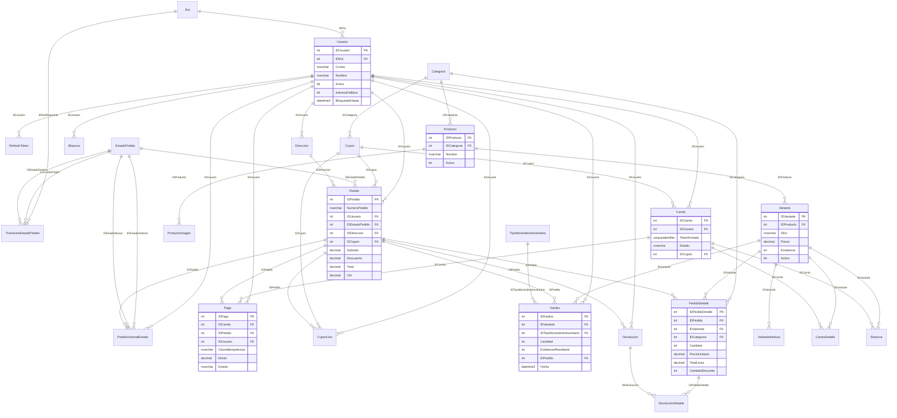
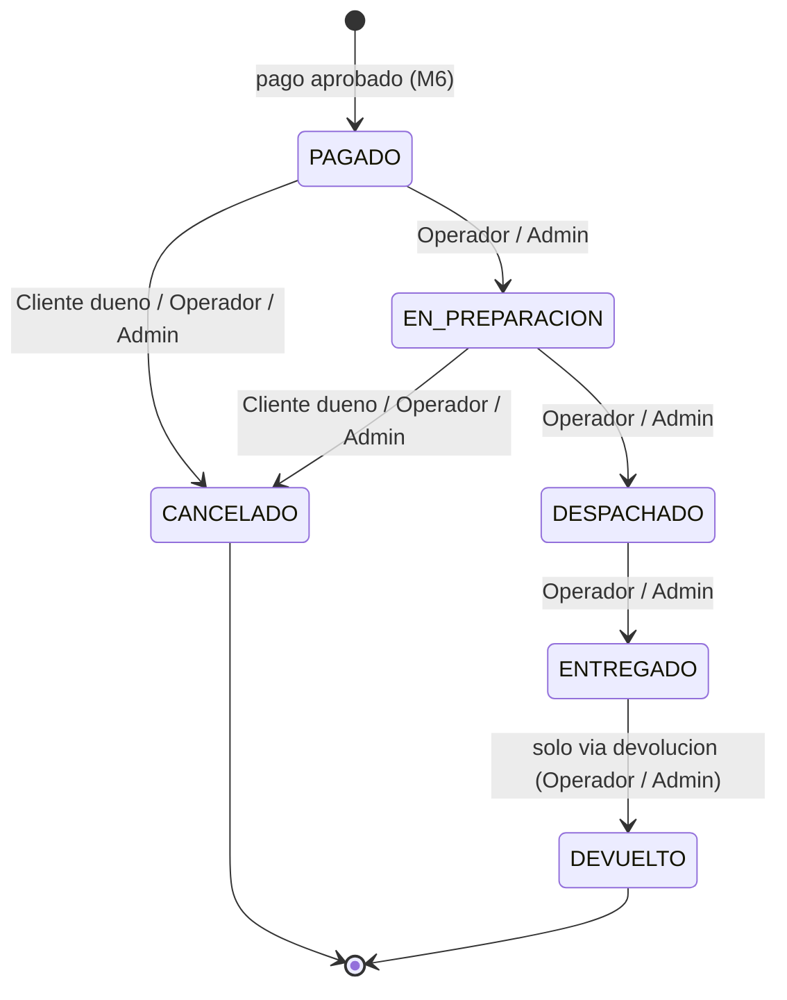

# ShopCart

Backend de e-commerce para las gasolineras y tienda de conveniencia "Don Arturo /
RinoMart". Monorepo: la base de datos en `db/` y la API en `api/`.

## Descripcion

ShopCart es una API REST respaldada por SQL Server en la que **toda la logica de datos
vive en stored procedures** (el backend nunca arma SQL). Esta entrega corresponde a la
**Fase 1** y cubre los requisitos funcionales RF-01 a RF-09:

| RF | Modulo | Resumen |
|----|--------|---------|
| RF-01 | Autenticacion y usuarios | Registro/login con JWT, refresh tokens rotados, roles (Cliente/Operador/Administrador), direcciones. |
| RF-02 | Catalogo | Categorias, productos, variantes (SKU/precio) con atributos e imagenes. |
| RF-03 | Inventario y kardex | Existencia por variante con kardex inmutable; un unico SP la modifica. |
| RF-04 | Carrito | Carrito de cliente o de invitado (token), totales e IVA. |
| RF-05 | Cupones | Porcentaje/monto, vigencia, limites y categoria; validar/aplicar al carrito. |
| RF-06 | Checkout y pago | Reserva de existencia, pago simulado idempotente, creacion de pedido. |
| RF-07 | Pedidos y devoluciones | Maquina de estados, cancelacion y devoluciones (parcial/total). |
| RF-08 | Dashboard y reportes | Ventas por periodo/categoria, top productos, carritos abandonados, comparativo, export a Excel. |
| RF-09 | Bitacora | Auditoria inmutable de cambios con el usuario responsable. |

Extras: rate limiting, cache de reportes con invalidacion por evento y exportacion a
Excel. La **Fase 2** (front-end web) queda fuera del alcance de esta entrega.

## Stack

- **SQL Server 2022** (requiere `DATETRUNC`, de 2022).
- **Node.js 24 LTS** + **TypeScript** en modo `strict` (sin ORM; acceso solo por SP).
- **Express 5** (HTTP), **mssql** (driver, `request.execute`), **zod** (validacion).
- **pino** / **pino-http** (logs), **bcryptjs** (hash de contrasena),
  **jsonwebtoken** (JWT), **express-rate-limit** (rate limiting), **exceljs** (export).
- **helmet**, **cors**; documentacion **OpenAPI 3** via **swagger-ui-express**.

## Requisitos

- SQL Server 2022 (Developer/Express sirven).
- `sqlcmd` del cliente **ODBC 18** (o **go-sqlcmd**); el instalador usa `-C` (confia en
  el certificado) y `-b` (aborta al primer error).
- Node.js **24 LTS** y npm.
- Opcional, para las pruebas de API: Postman o **newman** (`npx newman`).

## Instalacion

> **Evaluadores: empiece por aqui** -> [`docs/GUIA-EVALUACION.md`](docs/GUIA-EVALUACION.md):
> recorrido guiado de 10 minutos, mapa RF -> evidencia, pruebas automatizadas y punteros
> de codigo para la defensa.

### 0. Probar sin instalar (ambiente desplegado)

La API ya esta desplegada en **https://jeanrodas.lat** (modo demo). Sin instalar nada:

- https://jeanrodas.lat/ — metadatos (nombre, version, fase, enlaces)
- https://jeanrodas.lat/health — estado del servicio y de la BD
- https://jeanrodas.lat/api-docs — Swagger (OpenAPI 3)

Para probar con Postman, importe `docs/postman/ShopCart.postman_collection.json` y ponga
la variable `baseUrl` en `https://jeanrodas.lat`. Al correr en modo demo (rate limits
altos y pago simulado habilitado), se puede ejecutar tanto el recorrido guiado como la
coleccion completa.

Para instalar en local, siga los pasos 1 a 5 en orden.

### 1. Clonar el repositorio

```bash
git clone <url-del-repo> shopcart
cd shopcart
```

### 2. Base de datos

Requiere SQL Server 2022. Desde `db/`, el instalador aplica los scripts en el unico orden
canonico valido y verifica el resultado (detalle en [`db/README.md`](db/README.md)).
Elija segun como autentique contra su SQL Server:

```powershell
cd db
.\aplicar.ps1                                  # autenticacion de Windows (la mas comun en local)
.\aplicar.ps1 -User sa -Password '<pass>'      # autenticacion SQL (usuario sa)
```

- **Instancia con nombre:** agregue `-Server 'localhost\SQLEXPRESS'`.
- **Sin semillas de demo:** agregue `-IncluirSemillas:$false`.
- **En bash/Linux:** `./aplicar.sh` con las mismas opciones (`-u sa -p '<pass>'`, `-s`).

Al terminar imprime los conteos de verificacion: **26 tablas**, procedimientos, triggers,
vistas y el login `shopcart_app`. Si ves "Instalacion completada", esta lista.

> **Avisos esperados (no son errores).** Al aplicar `014`, SQL Server emite "The module '…'
> depends on the missing object 'dbo.SP_Carrito_Obtener'… will still be created": es normal
> porque en el orden canonico `012` (que crea ese SP) va **despues** de `014`; la resolucion
> es diferida. Ademas `099` imprime varios result sets al generar los pedidos demo: es ruido
> de salida, no un error.

**Si falla:**

- **`sqlcmd: command not found` / no se reconoce:** instale el cliente de linea de comando.
  [Microsoft ODBC Driver 18 + sqlcmd](https://learn.microsoft.com/sql/connect/odbc/download-odbc-driver-for-sql-server)
  o el nuevo [go-sqlcmd](https://learn.microsoft.com/sql/tools/sqlcmd/sqlcmd-utility).
- **Error de certificado (SSL/trust):** el instalador ya pasa `-C` (confia en el certificado);
  si usa otra herramienta, agregue esa opcion.
- **Error de login / permisos:** el `001` crea la base, asi que el usuario con el que corre
  `aplicar` necesita permiso de **`CREATE DATABASE`** (p. ej. `sa`, o un login con rol
  `dbcreator`/`sysadmin`). Con un usuario sin ese permiso, `001` falla.

### 3. API

```bash
cd api
npm ci                      # instala dependencias exactas del package-lock
cp .env.example .env        # copie la plantilla
npm run dev                 # desarrollo con recarga (tsx watch)
```

`api/.env.example` ya trae valores listos para **evaluacion local**: la clave de
desarrollo de `shopcart_app`, secretos JWT validos (>= 32 chars), `PAGO_SIMULADO=true` y
los tres `RATE_LIMIT_*_MAX=100` (permiten correr toda la coleccion de Postman de una
pasada). **Solo** edite `DB_SERVER`, `DB_USER` o `DB_PASSWORD` en `.env` si su SQL Server
difiere del ejemplo. (Estas variables tambien pueden pasarse como variables de entorno al
arrancar; ver "Variables de entorno".)

Otros scripts: `npm run build` (compila a `dist/`), `npm start` (corre la build),
`npm run lint`, `npm run format`.

### 4. Verificar

La API queda en `http://localhost:3000` (segun `PORT`):

- `GET http://localhost:3000/health` — estado del servicio y de la BD (`db: "ok"`).
- `GET http://localhost:3000/api-docs` — documentacion Swagger (OpenAPI 3).
- Todo el resto vive bajo `http://localhost:3000/api/v1` (auth, usuarios, catalogo,
  inventario, carrito, cupones, checkout, pedidos, bitacora, reportes).

Para el primer login (datos de semilla, ver [Credenciales de prueba](#credenciales-de-prueba)):

| Correo | Contrasena | Rol |
|--------|-----------|-----|
| `admin@shopcart.local` | `Admin123!` | Administrador |
| `operador@shopcart.local` | `Operador123!` | Operador |
| `cliente@shopcart.local` | `Cliente123!` | Cliente |

### 5. Probar

Importe `docs/postman/ShopCart.postman_collection.json` en Postman y siga la
**[Guia de evaluacion](docs/GUIA-EVALUACION.md)**: empiece por la carpeta
**`00 Recorrido guiado`** (narrativa de RF-01 a RF-09 en ~17 requests con Send). Ver tambien
la seccion [Pruebas](#pruebas).

### Produccion

Diferencias respecto a la evaluacion local: `NODE_ENV=production`; `MODO_DEMO=false` y
`PAGO_SIMULADO=false` (en produccion el pago simulado solo se permite con `MODO_DEMO=true`,
reservado a un ambiente publico de demostracion); `TRUST_PROXY` igual al numero de proxies
propios delante de la API; secretos JWT y contrasena de BD fuertes y **rotados** fuera del
control de versiones; y los `RATE_LIMIT_*_MAX` en sus valores reales (no 100). El archivo de
semillas `099` no se aplica en produccion. Ver [Despliegue](#despliegue) y `deploy/README.md`.

## Variables de entorno

Se definen en `api/.env` (plantilla en `api/.env.example`). La aplicacion valida
estas variables al arrancar con zod y **no inicia** si falta alguna o es invalida.

Esta tabla refleja 1:1 las claves que valida `api/src/config/env.ts` (y `api/.env.example`).
"Obligatoria" = sin valor por defecto (la app no arranca si falta).

| Variable | Descripcion | Default | Obligatoria |
|----------|-------------|---------|:-----------:|
| `NODE_ENV` | Entorno de ejecucion (`development`/`test`/`production`) | `development` | No |
| `PORT` | Puerto HTTP de la API | `3000` | No |
| `DB_SERVER` | Host/instancia de SQL Server | — | **Si** |
| `DB_PORT` | Puerto de SQL Server | `1433` | No |
| `DB_NAME` | Nombre de la base de datos | — | **Si** |
| `DB_USER` | Usuario de SQL Server | — | **Si** |
| `DB_PASSWORD` | Contrasena de SQL Server | — | **Si** |
| `DB_ENCRYPT` | Cifrar la conexion (`true`/`false`) | `true` | No |
| `DB_TRUST_SERVER_CERT` | Confiar en el certificado del servidor | `false` | No |
| `DB_REQUEST_TIMEOUT_MS` | Timeout de cada request a SQL Server (ms) | `30000` | No |
| `CORS_ORIGIN` | Origenes permitidos (separados por coma) | — | **Si** |
| `JWT_ACCESS_SECRET` | Secreto del access token (min. 32 chars) | — | **Si** |
| `JWT_REFRESH_SECRET` | Secreto del refresh token (min. 32 chars) | — | **Si** |
| `JWT_ACCESS_EXPIRES` | Vigencia del access token | `15m` | No |
| `JWT_REFRESH_EXPIRES` | Vigencia del refresh token | `7d` | No |
| `RESERVA_JOB_SEGUNDOS` | Intervalo del job que libera reservas vencidas (s) | `60` | No |
| `LOG_LEVEL` | Nivel de log de pino (`trace`..`fatal`, `silent`) | `info` | No |
| `REPORTES_CACHE_TTL_SEGUNDOS` | Vigencia del cache de reportes (RF-08); `0` lo desactiva | `60` | No |
| `RATE_LIMIT_AUTH_MAX` | Intentos a `/auth/*` por IP por ventana | `10` | No |
| `RATE_LIMIT_AUTH_VENTANA_MIN` | Ventana del rate limit de auth (min) | `15` | No |
| `RATE_LIMIT_CHECKOUT_MAX` | Operaciones de checkout por usuario por minuto | `20` | No |
| `RATE_LIMIT_CUPON_MAX` | Aplicaciones de cupon por identidad por minuto | `10` | No |
| `TRUST_PROXY` | Saltos de proxy de confianza para derivar la IP (Express `trust proxy`); `0` = sin proxy | `0` | No |
| `MODO_DEMO` | Permite `PAGO_SIMULADO=true` en un ambiente de produccion de demostracion | `false` | No |
| `PAGO_SIMULADO` | Pago simulado (desarrollo/demo); en produccion solo con `MODO_DEMO=true` | `false` | No |

> La configuracion de **negocio** (minutos de reserva, horas de abandono de carrito,
> porcentaje de IVA, stock minimo, costo de envio) NO esta en `.env`: vive en la tabla
> `dbo.Parametro` y la leen los stored procedures.

## Scripts de base de datos

Se aplican con `db/aplicar.ps1` (o `aplicar.sh`) en el **orden canonico unico** definido
en ese instalador; el detalle, la idempotencia y el equivalente manual estan en
[`db/README.md`](db/README.md). El orden de ejecucion actual es:

```
001 002 003 004 005 006 007 008 025 009 010 011 013 014 012 015 017 019 020 021 022 016 018 023 024 026 [099]
```

`012` va despues de `013`/`014` (su funcion de totales referencia la columna `Carrito.IDCupon`
y las funciones de cupon) y `016`/`018` van despues de `022` (sus SPs referencian las columnas
`NombreFactura`/`NITFactura` que agrega `022`, y `CREATE OR ALTER` las valida al compilar).
`023`, `024`, `026` y `027` (Fase 2) van despues de `018` y solo agregan objetos (no alteran los de `018`).
`026` (operacion del area interna) y `027` (control: cupones, bitacora y usuarios) cierran la
lista: solo leen/extienden objetos ya creados. La
tabla describe cada script en orden numerico de archivo:

| Script | Descripcion |
|--------|-------------|
| `001_CreateDatabase.sql` | Base de datos `ShopCart` y modelo relacional (26 tablas). |
| `002_SP_Sistema_Ping.sql` | `dbo.SP_Sistema_Ping` para `/health`. |
| `003_Security.sql` | Login `shopcart_app` (solo `EXECUTE`) y bitacora inmutable. |
| `004_Catalogos.sql` | Roles, tipos de movimiento de inventario, parametros, indice de usuarios. |
| `005_SP_Auth.sql` | SPs de autenticacion (registro, login, refresh tokens). |
| `006_SP_Usuarios.sql` | SPs de gestion de usuarios (Administrador). |
| `007_SP_Direcciones.sql` | SPs de direcciones del usuario. |
| `008_VW_Inventario.sql` | Vista de inventario disponible, indice de busqueda y TVP de atributos. |
| `009_SP_Categorias.sql` | SPs de categorias del catalogo (RF-02). |
| `010_SP_Catalogo.sql` | SPs de productos, variantes e imagenes (RF-02). |
| `011_SP_Inventario.sql` | SPs de inventario y kardex (RF-03). |
| `012_SP_Carrito.sql` | Funcion de totales y SPs del carrito de compras (RF-04). En M5 la funcion de totales pasa a descontar el cupon, por eso se reaplica despues de `014`. |
| `013_Migracion_CarritoCupon.sql` | Migracion posterior al `001`: agrega `Carrito.IDCupon` y su FK para recordar el cupon aplicado antes del checkout (RF-05). |
| `014_SP_Cupones.sql` | Funciones (`FU_Cupones_CalculoDescuento`, `FU_Cupones_Estado`) y SPs de cupones: validar/aplicar/quitar y CRUD de administracion (RF-05). |
| `015_Catalogo_EstadosPedido.sql` | Estados de pedido y transiciones permitidas; base del ciclo de vida (RF-06, RF-07). Idempotente. |
| `016_SP_Checkout.sql` | Reserva de existencia, checkout en dos pasos, pago simulado idempotente y creacion de pedido (RF-06): `SP_Inventario_ReservarExistencia`, `SP_Checkout_Iniciar`/`_Resumen`, `SP_Pedidos_CrearPedido`, `SP_Checkout_LiberarReservasVencidas`. |
| `017_Migracion_CarritoTokenUnico.sql` | Migracion posterior al `001`: cambia la unicidad del token de invitado a un indice unico filtrado para tolerar multiples NULL (RF-06). |
| `018_SP_Pedidos.sql` | Pedidos (RF-07): ciclo de vida (`SP_Pedidos_CambiarEstado`), devoluciones (`SP_Pedidos_RegistrarDevolucion` con `TVP_DevolucionLinea`), consulta (`SP_Pedidos_Obtener`), listado (`SP_Pedidos_Listar`) y el trigger `TR_Pedido_TransicionValida`. |
| `019_Bitacora.sql` | Bitacora de auditoria (RF-09): triggers set-based que registran altas/cambios/bajas de productos, variantes, kardex, cupones y estados de pedido (`TR_Producto_Bitacora`, `TR_Variante_Bitacora`, `TR_Kardex_Bitacora`, `TR_Cupon_Bitacora`, `TR_PedidoHistorialEstado_Bitacora`), la consulta (`SP_Bitacora_Consultar`), los modulos (`SP_Bitacora_Modulos`) y el helper `SP_Bitacora_Registrar`. |
| `020_Reportes.sql` | Dashboard y reportes (RF-08): vistas `VW_Reportes_PedidoNeto` y `VW_Reportes_LineaNeta` (venta neta de devoluciones) y SPs `SP_Reportes_VentasPorPeriodo` (DIA/SEMANA/MES con `DATETRUNC`), `SP_Reportes_VentasPorCategoria`, `SP_Reportes_TopProductos`, `SP_Reportes_CarritosAbandonados` y `SP_Reportes_Resumen` (con comparativo del periodo anterior); indice de apoyo `IX_Devolucion_Pedido_Monto`. |
| `021_SP_Catalogo_Publico.sql` | SPs publicos para la tienda (frontend): `SP_Cupones_Vigentes` (cupones aplicables ahora, sin exponer limites ni usos) y `SP_Catalogo_Destacados` (mas vendidos de 30 dias + ofertas por cupon de categoria). |
| `022_Migracion_PedidoFacturacion.sql` | Migracion aditiva: columnas `NombreFactura` y `NITFactura` (snapshot) en `dbo.Pedido` y `CHECK CK_Pedido_NITFactura` (NULL, `CF` o inicia con digito). Idempotente. |
| `023_SP_Pedidos_Cliente.sql` | Fase 2 (solo lectura): `SP_Pedidos_ListarCliente` (listado enriquecido del cliente con filtro de estado por lista `STRING_SPLIT`, busqueda por numero, hasta 3 imagenes y resumen de nombres), `SP_Pedidos_ResumenCliente` (conteos por estado, total comprado y envio en curso) y `SP_Pedidos_PagoCliente`. Aditivo: no altera `018`. |
| `024_SP_Fase2_Cuenta.sql` | Fase 2 (aditivo): columna `Usuario.Telefono`; perfil del cliente (`SP_Usuarios_ObtenerPerfil`/`SP_Usuarios_ActualizarPerfil`); cambio de contrasena (`SP_Auth_ObtenerHashPorID` + `SP_Auth_CambiarContrasena`, que revoca toda la cadena de refresh); y `SP_Catalogo_ListarAdmin` (listado de administracion con estado derivado por `CASE`, SKUs via `STRING_AGG`, filtros y conteos). Ademas `009` suma `CantidadProductosTotal` y `021` excluye de destacados los productos sin existencia disponible. |
| `025_Migracion_VarianteImagen.sql` | Fase 2 (aditivo): columna `dbo.Variante.ImagenURL` (imagen propia por variante; `NULL` = usa la del producto). Reordenada **antes** de `010/012/016/018/023/024`, que la referencian. Los SPs de crear/actualizar variante reciben `@ImagenURL` y `@ConservarImagen` (1 por defecto: no toca la imagen, para no romper M2); `ObtenerProducto` devuelve `ImagenURL`; `ListarAdmin` suma `VariantesConImagen`; carrito/pedido/resumen usan `COALESCE(v.ImagenURL, <imagen del producto>)`. |
| `026_SP_Fase2_Operacion.sql` | Fase 2 (aditivo, F7): operacion del area interna. `SP_Inventario_ListarAdmin` (tabla por variante con presentacion, existencia/reservado/disponible, ultimo movimiento, imagen y chips `bajoStock`/`agotadas`/`conReservas`); `SP_Inventario_Resumen` (KPIs + movimientos de hoy por tipo + inconsistencias + `UmbralBajoStock`/`ReservaMinutos`); `SP_Inventario_SimularMovimiento` (vista previa **solo lectura**: `Permitido`/`Motivo`); `SP_Pedidos_ResumenOperacion` (conteos del flujo y antiguedad del PAGADO mas viejo); `SP_Pedidos_ListarOperacion` (estado por lista `STRING_SPLIT`, busqueda por numero/nombre/correo, rango y columnas de operacion). Solo lectura/simulacion: el registro real y los cambios de estado siguen en `011`/`018`. Va al final. |
| `027_SP_Fase2_Control.sql` | Fase 2 (aditivo, F8): control del area interna. Cupones (`SP_Cupones_ListarAdmin` con estado derivado/alcance/dias-para-vencer y filtros; `SP_Cupones_ResumenAdmin` con KPIs de 30 dias y conteos por estado), bitacora (`SP_Bitacora_Consultar` +`@Texto` LIKE sobre los JSON; `SP_Bitacora_ListarPorRegistro`) y usuarios (`SP_Usuarios_ListarAdmin` con pedidos/bloqueo/conteos; `SP_Usuarios_Desbloquear`). No altera los SP de M1/M5/M8. Va al final. |
| `099_Semillas.sql` | Datos de ejemplo: usuarios/direccion (M1), catalogo (M2), carga de inventario (M3), carritos (M4), cupones (M5) y ~12 pedidos de demostracion con fechas repartidas (M6-M9); asigna la imagen propia (`/img/productos/<SKU>.jpeg`) a las tres presentaciones del Refrigerante. Se aplica al final. |

## Decisiones tecnicas

**Configuracion: negocio en BD, tecnica en env.** La configuracion de **negocio**
(minutos de reserva, horas de abandono de carrito, porcentaje de IVA, stock minimo,
costo de envio, etc.) vive en la tabla `dbo.Parametro` y la leen los stored procedures;
asi se ajusta sin redesplegar la API. La configuracion **tecnica** (conexion, secretos
JWT, niveles de log, TTL de cache, limites de rate limit, `TRUST_PROXY`) vive en
variables de entorno validadas por zod en `api/src/config/env.ts`, unico modulo que lee
`process.env`.

**Login con respuesta uniforme (anti-enumeracion).** `POST /auth/login` responde
SIEMPRE `401 'Credenciales invalidas'` ante usuario inexistente, contrasena incorrecta,
cuenta bloqueada o desactivada; la causa real solo va a `logger.warn` (con `requestId` y
el correo enmascarado, nunca la contrasena). Se mantiene una comparacion bcrypt dummy y
se hace la comparacion antes de los chequeos de estado para igualar los tiempos de
respuesta, de modo que un atacante no distingue que cuentas existen o estan bloqueadas.

**Ventana del access token (15 min).** El rol viaja dentro del access token (JWT,
`JWT_ACCESS_EXPIRES=15m`). Al cambiar el rol o desactivar un usuario, los SPs de M1
revocan sus refresh tokens activos para forzar re-login; el access token ya emitido
sigue valido hasta 15 min. Es una decision documentada: se acepta esa ventana a cambio
de no mantener una lista de revocacion de access tokens.

**Confianza en el proxy.** `app.set('trust proxy', TRUST_PROXY)`: con `0` (default) la IP
es la del socket; detras de un proxy/balanceador propio se fija al numero de saltos para
que `req.ip` (y por tanto el rate limiting por IP) use el `X-Forwarded-For` correcto.

**Acceso a datos exclusivo por stored procedures.** El backend nunca arma SQL.
El unico punto de acceso es `executeSp(spName, params)` (`api/src/data/spExecutor.ts`),
que ejecuta `request.execute(spName)` con parametros tipados (`request.input`/
`request.output`). No existe `batch()`, `query()` ni cadenas con comandos SQL en
el codigo TypeScript. `assertIdentifier` valida el nombre del SP y de los
parametros como defensa adicional, aunque siempre provienen del codigo.

**Auditoria de bitacora via session context.** Todo SP que **escribe** datos
recibe `@IDUsuarioEjecuta INT` como un parametro tipado mas (puede ser `NULL`
solo en el registro de clientes, donde aun no hay actor) y, como primera
instruccion, publica ese valor en el contexto de sesion:

```sql
EXEC sys.sp_set_session_context @key = N'IDUsuario', @value = @IDUsuarioEjecuta;
```

Los triggers de bitacora leen el autor con `SESSION_CONTEXT(N'IDUsuario')`. El
backend **no** fija el contexto de sesion por su cuenta: solo pasa
`@IDUsuarioEjecuta` dentro de `params`, como cualquier otro parametro del SP.

**Bitacora inmutable.** `dbo.Bitacora` es append-only. Ver
[Credenciales de prueba](#credenciales-de-prueba) y `db/scripts/003_Security.sql`:
el usuario de aplicacion solo tiene `EXECUTE` sobre `dbo` (sin permisos de tabla),
y un trigger `INSTEAD OF UPDATE, DELETE` bloquea cualquier modificacion o borrado,
incluso desde `dbo` o un SP.

### Decisiones de seguridad

Un resumen del modelo de amenazas y las decisiones que lo sostienen (los detalles
tecnicos estan en las notas de arriba y en cada modulo).

- **Sesion por JWT en el header, no en cookies.** El access token viaja en
  `Authorization: Bearer` y el front lo guarda del lado del cliente; al no usar cookies
  de sesion, **CSRF no aplica** (no hay credencial que el navegador adjunte sola) y por
  eso no se incluye proteccion anti-CSRF.
- **Ventana de 15 minutos del access token.** El rol viaja firmado dentro del token. Al
  hacer logout, desactivar un usuario o cambiarle el rol se revocan sus refresh tokens
  (no podra renovar), pero el access token ya emitido sigue valido hasta 15 min. Se
  acepta esa ventana a proposito: evita mantener una lista de revocacion de access
  tokens consultada en cada request, a cambio de una exposicion corta y acotada.
- **Lockout en dos capas.** Capa 1, en memoria por `(correo + IP)`: tras 5 fallos en 15
  min desde la misma IP para el mismo correo se rechaza sin tocar la BD. Capa 2, por
  cuenta en BD (`Usuario.IntentosFallidos`, umbral `LOGIN_MAX_INTENTOS = 10`). La capa 1
  frena la fuerza bruta desde una IP **sin** permitir que un atacante bloquee la cuenta
  de un tercero (el bloqueo por IP+correo no afecta a otras IPs). Un login exitoso limpia
  ambas.
- **Rate limiting por recurso y por identidad justa.** `/auth/*` por IP; checkout por
  usuario; aplicacion/validacion de cupones por identidad (usuario o token de invitado).
  La clave es la identidad, no solo la IP, para no castigar a varios clientes tras un NAT.
- **Respuestas uniformes.** El login responde siempre `401 'Credenciales invalidas'`
  (no distingue inexistente / mala contrasena / bloqueado / desactivado) y el acceso a
  una direccion ajena responde `404` igual que una inexistente: no se filtra la
  existencia de cuentas ni de recursos. La causa real queda en el log.
- **Sin recuperacion de contrasena en Fase 1.** Queda fuera de alcance; cuando se
  implemente llevara su propio rate limit por correo y por IP y un token de un solo uso
  con expiracion corta.
- **Cabeceras de seguridad.** `helmet` (con `Cross-Origin-Resource-Policy: same-origin`)
  mas `Permissions-Policy: camera=(), microphone=(), geolocation=()` fijada a mano
  (helmet 8 no la trae). CORS restringe los origenes a `CORS_ORIGIN`.
- **Validacion de entrada con lista blanca.** Los campos de texto que se muestran o
  exportan (nombres, alias, direccion, motivos) pasan por `textoPlano`, que rechaza
  caracteres de control y `< >` (anti-inyeccion de markup y de formulas en el `.xlsx`,
  junto con el prefijo de apostrofo del export). Las descripciones largas solo filtran
  caracteres de control.
- **Acceso a datos solo por stored procedures** (sin SQL en el backend) y **bitacora
  inmutable** en tres capas (ver arriba).
- **Credenciales de evaluacion.** Las contrasenas sembradas y la de BD son publicas y
  de desarrollo; en produccion no se aplica el seed y se rotan (ver
  [Credenciales de prueba](#credenciales-de-prueba)).

### Autenticacion y usuarios (M1, RF-01)

- **Hash de contrasenas con `bcryptjs`** (cost 10): implementacion en JS puro, sin
  binarios nativos, para garantizar portabilidad en una maquina limpia (no depende
  de `node-gyp` ni toolchain de compilacion).
- **Refresh token en el cuerpo JSON, no en cookie.** Trade-off deliberado: el
  frontend del reto es una SPA que guarda el token y lo envia explicitamente; evita
  la complejidad de CSRF y de la configuracion de cookies cross-site. El costo es
  que el almacenamiento seguro del refresh queda a cargo del cliente.
- **Rotacion con deteccion de reutilizacion.** Cada refresh se guarda como hash
  SHA-256 (`CHAR(64)`). Al rotar, si llega un token ya revocado se asume robo: se
  revoca **toda la cadena activa** del usuario y se rechaza (401).
- **Lockout de login:** 5 intentos fallidos bloquean la cuenta 15 minutos
  (parametros `LOGIN_MAX_INTENTOS` / `LOGIN_BLOQUEO_MINUTOS`).
- **403 en recursos ajenos verificado en el SP.** La pertenencia de una direccion
  se valida dentro del stored procedure con el `@IDUsuario` del token, no en el
  backend; una direccion de otro usuario responde 403.
- **Usuario desactivado** se rechaza en el login y en el refresh. El access token
  (15 min) no se revoca: simplemente expira solo.
- **Rate limiting** en `/auth/registro`, `/auth/login` y `/auth/refresh`
  (`express-rate-limit`, valores en `.env`); el exceso responde 429 con el mismo
  formato de error del resto de la API.
- **JWT access token** firmado con `JWT_ACCESS_SECRET`, payload
  `{ sub, rol, nombre }`; el middleware `authenticate` adjunta `req.usuario` y
  `authorize(...roles)` restringe por rol.

### Catalogo de productos (M2, RF-02)

- **SKU, precio y existencia pertenecen a la variante.** El producto no tiene
  SKU: agrupa variantes. Un producto sin variantes activas no es vendible ni
  visible en tienda.
- **Baja logica siempre** (`Activo = 0`) para categorias, productos y variantes,
  incluso con ventas asociadas: `PedidoDetalle` y el kardex referencian la
  variante, asi que un borrado fisico romperia el historial. `CambiarEstadoProducto`
  devuelve `TieneVentas` como dato informativo. Las imagenes si se borran
  fisicamente (no las referencia nada).
- **El catalogo nunca escribe `Variante.Existencia`.** La variante nace en 0 y la
  existencia solo cambia por kardex (M3). Ningun SP de M2 toca esa columna.
- **Visible en tienda** = `Producto.Activo = 1` AND `Categoria.Activo = 1` AND al
  menos una variante activa. Desactivar un producto no cambia el `Activo` de sus
  variantes.
- **Disponibilidad** via `VW_Inventario_Disponible`: `Disponible = Existencia -`
  reservas activas no vencidas.
- **Busqueda sin SQL dinamico.** Filtros opcionales con el patron
  `(@Param IS NULL OR columna = @Param)`, `LIKE` con `CONCAT(N'%', @Texto, N'%')`,
  orden por lista blanca con expresiones `CASE` (nunca columna interpolada) y
  `OPTION (RECOMPILE)` para que el plan se ajuste a los filtros efectivos.
- **TVP para atributos.** Los atributos de variante se envian como un parametro de
  tipo tabla `dbo.TVP_VarianteAtributo` (objeto `sql.Table` de mssql) en una sola
  llamada; cero SQL en TypeScript.
- **Imagenes solo por URL** (no se suben binarios). Una imagen principal por
  producto, garantizada dentro del SP en una transaccion.
- **Lectura del catalogo:** publica sin token (`/catalogo/...`, siempre
  `IncluirInactivos = 0`), o de administracion para Administrador y Operador
  (acepta `incluirInactivos`). La **escritura** es exclusiva del Administrador.
- **404 uniforme** para un producto inexistente o inactivo en la ruta publica: la
  misma respuesta en ambos casos, para no revelar el catalogo oculto.

### Inventario y kardex (M3, RF-03)

- **Un unico SP escribe la existencia.** `SP_Inventario_RegistrarMovimiento` es el
  unico lugar que hace `UPDATE` sobre `Variante.Existencia`; ningun otro SP de ningun
  modulo la toca. Checkout, cancelacion y devolucion llaman a este SP desde sus propios
  SPs (`@OrigenInterno = 1`), nunca con un update directo.
- **Invariante `Existencia = SUM(Signo * Cantidad)` del kardex.** Cada fila de `Kardex`
  guarda `ExistenciaResultante`. `SP_Inventario_VerificarConsistencia` audita el
  invariante y el endpoint `GET /inventario/consistencia` (Administrador) debe devolver
  cero inconsistencias.
- **Tipos reservados al sistema.** La API solo expone `ENTRADA_COMPRA`,
  `AJUSTE_POSITIVO` y `AJUSTE_NEGATIVO`. `SALIDA_VENTA`, `DEVOLUCION` y `CANCELACION`
  exigen `@OrigenInterno = 1`, que solo envian los SPs de pedidos; el backend nunca
  expone ni envia ese parametro (intentarlo desde la API responde 403).
- **Ajuste negativo mas estricto que el fisico.** Un movimiento negativo no puede dejar
  la existencia fisica < 0 **ni** el disponible (`existencia - reservas activas no
  vencidas`) < 0. Es mas estricto que exigir solo existencia >= 0: evita vender o retirar
  unidades ya comprometidas por reservas de carritos vigentes, que romperian un checkout
  en curso.
- **Concurrencia.** El movimiento lee la variante con `WITH (UPDLOCK, HOLDLOCK)` dentro
  de la transaccion (aislamiento READ COMMITTED por defecto), serializando los
  movimientos concurrentes sobre la misma variante y evitando condiciones de carrera al
  recalcular la existencia.
- **Kardex inmutable de hecho:** solo hay `INSERT` sobre `Kardex`; ningun SP hace
  `UPDATE`/`DELETE` de movimientos. La correccion de un error se hace con un ajuste
  compensatorio, no editando el historial.
- **`STOCK_MINIMO`** vive en `dbo.Parametro` (= 5); el listado de existencias marca
  `BajoStock` cuando `Disponible <= STOCK_MINIMO` y acepta `soloBajoStock=true`.
- **Semillas via el SP.** La carga inicial de inventario (`099`) recorre las variantes
  activas sin kardex y llama a `SP_Inventario_RegistrarMovimiento` (ENTRADA_COMPRA);
  nunca hace `UPDATE` directo, de modo que la existencia sembrada tambien respeta el
  invariante.

### Carrito de compras (M4, RF-04)

- **El carrito no lleva ID en la URL.** Se identifica SIEMPRE por la identidad: el
  cliente autenticado usa su carrito `Activo` (se crea si no existe); el invitado usa
  el header `X-Cart-Token` (UUID). El middleware `cartIdentity` resuelve `req.carrito`
  y nunca se acepta un ID de carrito del cliente. Rutas: `GET /carrito`,
  `POST /carrito/items`, `PUT/DELETE /carrito/items/:idVariante`, `DELETE /carrito`.
- **Invitado por token UUID.** Si un invitado no envia header, el primer
  `POST /carrito/items` crea el carrito y la API devuelve el token en el header
  `X-Cart-Token` y en el cuerpo (`cartToken`). `GET /carrito` sin identidad ni header
  responde 200 con un carrito vacio sin crear nada.
- **Solo el servidor acuna tokens.** Un cliente no puede inventar un `X-Cart-Token`
  para materializar un carrito: el carrito de invitado se crea unicamente cuando el
  backend genera el UUID (`randomUUID`) en el primer `POST /carrito/items` sin header.
  `SP_Carrito_AgregarItem` recibe `@CrearSiNoExiste` y el servicio lo envia en 1 solo
  en ese caso; con un token desconocido las escrituras (`POST`/`PUT`/`DELETE` de item y
  `DELETE /carrito`) responden **404 `Carrito no encontrado`**. `GET /carrito` con un
  token desconocido sigue respondiendo 200 con el carrito vacio (sin error), para no
  filtrar la existencia de carritos.
- **Operador y Administrador no tienen carrito.** Cualquier ruta de `/carrito`
  responde 403 para esos roles; el carrito es exclusivo del rol Cliente. Si llegan
  Bearer de Cliente y `X-Cart-Token` a la vez, se ignora el header (manda la identidad).
- **Fusion en login/registro.** `POST /auth/login` y `POST /auth/registro` aceptan el
  header opcional `X-Cart-Token`; tras autenticar, el servicio llama a
  `SP_Carrito_Fusionar`. Si el token no existe o su carrito no esta `Activo`, no es
  error (se ignora). Las lineas del invitado se suman al carrito del usuario (creandolo
  si no existe) **topando cada cantidad al disponible**; el carrito invitado queda
  `Convertido`. La respuesta incluye `carritoFusionado: { lineas, advertencias }` o
  `null`.
- **Validacion suave de disponible; la reserva es del checkout.** El carrito nunca
  reserva existencia ni toca `Variante.Existencia`, `Kardex` ni `Reserva`: solo valida
  que la cantidad de la linea sea `<= Disponible` (`Existencia - reservas activas no
  vencidas`) en el momento de agregar/modificar. La reserva real ocurre en el checkout
  (M6). Por eso `GET /carrito` marca cada linea con `Advertencia` (sin existencia o no
  disponible) en vez de rechazarla: el disponible pudo cambiar despues de agregarla.
- **Regla de bloqueo heredada de M3.** Todo SP que lee el disponible para decidir una
  escritura bloquea primero la fila de `dbo.Variante` con `WITH (UPDLOCK, HOLDLOCK)`
  dentro de la transaccion y despues consulta `Reserva`. La fusion bloquea las variantes
  en orden de `IDVariante` para evitar deadlocks.
- **Totales y desglose de IVA en SQL con `DECIMAL(18,2)`.** `FU_Carrito_CalcularTotales`
  (funcion en linea, invocada solo desde SPs) calcula `TotalLinea = ROUND(Precio *
  Cantidad, 2)`, `Subtotal`, `Total = Subtotal - Descuento`, y el IVA incluido en el
  precio: `BaseImponible = ROUND(Total / (1 + IVA/100), 2)`, `IVA = Total -
  BaseImponible`. El `PorcentajeIVA` sale del parametro de IVA en `dbo.Parametro` (default 12).
  El backend nunca calcula montos.
- **Descuento = 0 en M4.** `Descuento` siempre es `0.00`; la funcion lo deja marcado
  para que **M5 (cupones)** lo sustituya. El cupon del carrito se resuelve en M5 con un
  script de migracion (no se agregaron columnas en M4).
- **Precio vigente en el carrito, congelado en el pedido.** Las lineas usan
  `Variante.Precio` actual; el precio se congela recien al crear el pedido (M6).
- **Limites.** Cantidad por linea entre 1 y 1000; maximo 50 lineas por carrito (la
  linea 51 responde 422). `PUT` fija la cantidad (no suma); `POST` suma a la existente.
- **Abandono como estado derivado (M9).** Cada escritura actualiza
  `FechaUltimaActividad`; el estado `Abandonado` lo derivara un proceso de M9. En las
  semillas el carrito de invitado nace con la fecha retrasada 3 dias (unico lugar donde
  se toca esa fecha a mano, y solo para datos de prueba).

### Cupones y promociones (M5, RF-05)

- **Migracion 013, no cambios en el 001.** El modelo base no se toca. `Carrito.IDCupon`
  (nullable, con FK a `Cupon`) se agrega en `013_Migracion_CarritoCupon.sql` para que el
  carrito recuerde el cupon aplicado **antes** del checkout. La migracion es idempotente
  (`COL_LENGTH` / `sys.foreign_keys`) y usa `GO` para que la columna exista antes de
  referenciarla. Orden de aplicacion de M5: **013 -> 014 -> 012 (se reaplica) -> 099**,
  porque `FU_Carrito_CalcularTotales` (012) depende de las funciones de cupon (014) y de
  la columna (013): una funcion en linea exige que lo referenciado exista al crearse.
- **Aplicar no es consumir.** M5 solo **valida y guarda** `Carrito.IDCupon`; nunca toca
  `Cupon.UsosActuales` ni inserta en `CuponUso`. El **consumo** de un uso es del checkout
  (M6): dentro de su transaccion, con `UPDATE Cupon SET UsosActuales = UsosActuales + 1
  WHERE ... AND (LimiteUsosTotal IS NULL OR UsosActuales < LimiteUsosTotal)` validando
  `@@ROWCOUNT`, con el `CHECK` de tabla como ultima defensa. Orden de bloqueo del
  checkout: `Carrito` -> `Variante` -> `Reserva` -> `Cupon`.
- **Cupones solo con sesion.** Son exclusivos del Cliente autenticado. En
  `POST`/`DELETE /carrito/cupon` el controlador exige `req.carrito.idUsuario`; un invitado
  recibe **401 `Inicie sesion para aplicar cupones`** antes de tocar la base.
- **Base elegible y formulas.** La base elegible es el subtotal de las lineas cuya
  `Producto.IDCategoria` coincide con `Cupon.IDCategoria` (si el cupon tiene categoria) o
  el subtotal completo. `PORCENTAJE -> ROUND(base * Valor / 100, 2)`; `MONTO -> el menor
  entre Valor y base`. El descuento nunca supera el `Subtotal`. Todo en `DECIMAL(18,2)` y
  calculado en SQL (`FU_Cupones_CalculoDescuento`); el backend no calcula montos.
- **Monto minimo contra el subtotal.** El `MontoMinimo` se compara contra el `Subtotal`
  completo del carrito (no contra la base elegible).
- **Validez en orden con mensaje propio.** `FU_Cupones_Estado` evalua y devuelve la
  primera causa que falla: (1) no existe o inactivo -> **404 `Cupon invalido`**; (2) aun
  no vigente, (3) vencido, (4) agotado, (5) limite por cliente alcanzado, (6) no alcanza
  el monto minimo (`... de Q X (faltan Q Y)`), (7) con categoria y base elegible 0 -> todas
  **422**. El codigo se normaliza con `UPPER(TRIM(...))`.
- **Re-validacion al mostrar.** `GET /carrito` recalcula el cupon guardado: si ya no
  cumple 1-7, `Descuento = 0` y el objeto `cupon.descuento` informa `valido: false` y la
  `causa`; **no** lanza error. `FU_Carrito_CalcularTotales` solo descuenta cuando el cupon
  sigue siendo valido.
- **Un cupon por carrito.** Aplicar uno reemplaza el anterior (`UPDATE Carrito SET
  IDCupon`). `DELETE /carrito/cupon` lo quita (sin error si no habia). Vaciar el carrito
  (`DELETE /carrito`) tambien quita el cupon: `SP_Carrito_Vaciar` pone `IDCupon = NULL`
  porque un carrito vacio no conserva cupon.
- **Cupon con usos congelado.** Un cupon con usos (`CuponUso` o `UsosActuales > 0`) no
  puede cambiar `Codigo`, `TipoDescuento`, `Valor` ni `IDCategoria` (**409**); si solo
  cambian fechas o limites, se permite. `SP_Cupones_Actualizar` nunca escribe
  `UsosActuales`.
- **Respuesta del carrito.** El servicio arma `cupon` desde el tercer recordset de
  `SP_Carrito_Obtener` como `{ IDCupon, Codigo, TipoDescuento, Valor, Categoria, descuento:
  { baseElegible, descuento, valido, causa } }` (o `null`). El `Descuento` del cupon ya
  esta reflejado en `carrito.totales`.

### Checkout y pago (M6, RF-06)

- **Dos pasos: reservar y luego pagar.** `POST /checkout/iniciar` **reserva** existencia
  por los minutos de reserva configurados en `dbo.Parametro` (default 15) y devuelve un resumen con totales y costo
  de envio; `POST /checkout/pagar` **cobra** (pago simulado) y, si aprueba, crea el pedido.
  Separar reserva de pago evita vender mas unidades de las que hay cuando varios clientes
  compiten por el ultimo stock.
- **Iniciar es reiniciable.** Vuelve a reservar: libera las reservas `Activa` del propio
  carrito y crea nuevas. Reintentar el checkout nunca acumula reservas duplicadas.
- **Pagar exige reserva vigente.** `SP_Pedidos_CrearPedido` verifica que **todas** las
  lineas tengan `Reserva` `Activa`, `FechaExpira > ahora` y la misma cantidad; si no,
  **409 `La reserva vencio o no existe; inicie el checkout de nuevo`**. Asi la reserva es
  el "boleto" que garantiza el stock entre los dos pasos.
- **Idempotencia en la base.** El header `Idempotency-Key` (16-100, `[A-Za-z0-9_-]`) se
  guarda como `Pago.ClaveIdempotencia` con `UNIQUE`. El SP bloquea el carrito
  (`UPDLOCK, HOLDLOCK`) y busca el pago por clave **dentro** del lock: si ya existe y es del
  mismo usuario, hace **replay** y devuelve exactamente el mismo resultado (sin tocar nada);
  si es de otro usuario, **409 `Clave de idempotencia en uso`**. El `UNIQUE` es la ultima
  defensa ante una carrera. Dos `pagar` con la misma clave devuelven el mismo
  `NumeroPedido` y el mismo codigo HTTP; uno trae `replay: true`.
- **Pago simulado y 402.** `simularResultado` (`APROBADO` por defecto) decide el desenlace.
  Aprobado responde **201** (se creo el pedido); rechazado responde **402 Payment
  Required** (semantica HTTP del pago que no prospera), registra el `Pago` `Rechazado`,
  **no** crea pedido y **deja las reservas intactas** para poder reintentar. En replay se
  repite el mismo codigo (201 o 402), deducido de `aprobado`.
- **Orden exacto de la transaccion aprobada.** (0) **pre-bloquear** las variantes del
  carrito en `IDVariante` ascendente (recorriendo `CarritoDetalle`, antes de leer totales y
  de construir `#Lineas`), (1) leer totales y armar el snapshot (`#Lineas` con prorrateo),
  (2) consumir reservas (`Estado = 'Consumida'`, solo vigentes; si el numero de reservas
  consumidas no iguala las lineas del carrito -> `409`), (3) crear `Pedido`, (4)
  `PedidoDetalle`, (5) un `SP_Inventario_RegistrarMovimiento` `SALIDA_VENTA` por linea, (6)
  uso del cupon, (7) `Pago` aprobado, (8) `Carrito` `Convertido`, (9) historial de estado.
  **Las reservas se consumen ANTES del kardex** porque `SP_Inventario_RegistrarMovimiento`
  descuenta del disponible las reservas activas; si siguieran `Activa`, la salida de venta
  de la misma cantidad se bloquearia a si misma.
- **Orden de bloqueo anti-deadlock.** `Carrito (UPDLOCK, HOLDLOCK)` -> `Variante
  (UPDLOCK, HOLDLOCK, IDVariante ascendente)` -> `Reserva` -> `Cupon (UPDLOCK)`. En la rama
  aprobada se **pre-bloquean** primero todas las variantes del carrito en `IDVariante`
  ascendente (un `SELECT ... WITH (UPDLOCK, HOLDLOCK)` por cada una) y solo despues se
  consumen las reservas y se registra el kardex. El pre-bloqueo es necesario: sin el, entre
  consumir la reserva (que la quita del disponible) y registrar la salida de venta, otro
  carrito podria reservar esa unidad y el pago fallaria. Con el, el orden se cumple de forma
  literal y las variantes quedan retenidas hasta el `COMMIT`.
- **SPs anidados.** `SP_Inventario_RegistrarMovimiento` abre su propio `BEGIN TRAN/COMMIT`
  dentro de la transaccion de `CrearPedido` (el commit interno solo decrementa
  `@@TRANCOUNT`). Un `THROW` interno ya hizo `ROLLBACK` de todo y relanza; el `CATCH`
  exterior encuentra `@@TRANCOUNT = 0` y solo relanza. Se le pasa `@SinResultado = 1` para
  que **no** devuelva un result set por cada movimiento y asi no contaminar la salida.
- **Snapshot y prorrateo del descuento.** El pedido guarda un snapshot inmutable: `SKU`,
  `NombreProducto`, `DescripcionVariante` (`STRING_AGG` de los atributos), `IDCategoria`,
  `PrecioUnitario` y el `DescuentoLinea` **prorrateado**. Por linea elegible,
  `DescuentoLinea = ROUND(Descuento * TotalLineaBruta / BaseElegible, 2)`; la ultima linea
  elegible (mayor `IDVariante`) absorbe el redondeo para que `SUM(DescuentoLinea) =
  Descuento` al centavo; las no elegibles van en 0. `TotalLinea = bruto - DescuentoLinea`.
- **Numero de pedido legible.** `NumeroPedido = 'SC-' + FORMAT(NEXT VALUE FOR
  SEQ_Pedido_Numero, '000000')` (p.ej. `SC-000001`), con `UNIQUE`.
- **IVA sobre el total con envio.** El costo de envio **grava IVA**: la base imponible y el
  IVA se calculan sobre el total **con** envio, no sobre el del carrito. La formula es
  `BaseImponible = ROUND(Total / (1 + IVA/100), 2)` e `IVA = Total - BaseImponible`, con
  `Total = Subtotal - Descuento + CostoEnvio`. `FU_Carrito_CalcularTotales` (012) **no**
  cambia (es del carrito, sin envio); por eso `SP_Checkout_Iniciar` y `SP_Checkout_Resumen`
  recalculan `BaseImponible`/`IVA` sobre `TotalConEnvio` con esa misma formula (no usan los
  de la funcion). `SP_Pedidos_CrearPedido` ya persiste el pedido con esta regla.
- **Estados y ciclo de vida.** `015` siembra `EstadoPedido` y `TransicionEstadoPedido`.
  El pedido nace en `PAGADO`; el grafo de transiciones y los roles estan en
  [Ciclo de vida del pedido](#ciclo-de-vida-del-pedido).
- **Liberacion de reservas por job + consulta.** `SP_Checkout_LiberarReservasVencidas`
  marca `Liberada` toda reserva `Activa` vencida (sin `session context`: actor nulo). El
  job `jobs/liberarReservas.ts` lo llama cada `RESERVA_JOB_SEGUNDOS` (default 60), loguea
  solo si libero algo y nunca tumba el proceso (errores capturados); arranca tras escuchar
  y se detiene en el apagado. Una bandera `enEjecucion` evita el solapamiento: si una
  corrida sigue viva (base lenta), la siguiente se salta ese ciclo y lo registra. El Administrador puede dispararlo a mano con
  `POST /checkout/reservas/liberar`. El disponible se lee en vivo de
  `VW_Inventario_Disponible` (existencia - reservas activas no vencidas).
- **Prueba de concurrencia.** `api/tests/concurrencia.mjs` (Node 24 puro, solo HTTP) crea
  una variante con **1 unidad**, registra 10 clientes que compiten y verifica: 10
  `iniciar` en paralelo -> **1x201 / 9x409**; dos `pagar` del ganador con la misma clave ->
  ambos **201**, mismo `NumeroPedido`, uno con `replay`; `GET /inventario/consistencia` ->
  `consistente: true`; un perdedor reintenta -> **409**; un pago **RECHAZADO** -> **402** con
  monto numerico y reintento **APROBADO** -> **201**; cliente B reutiliza la clave de A ->
  **409** sin `pedido`; y tras el pedido la variante en contienda queda en `Existencia=0`,
  `Reservado=0`. Se corre con la API arriba:
  `BASE_URL=http://localhost:3000 npm run test:concurrencia` (sale con codigo 1 si algun
  escenario falla). Registra 10 clientes + login admin, asi que conviene correr la API con
  `RATE_LIMIT_AUTH_MAX` alto (p.ej. 100); con el default (10) el limitador devuelve 429. El
  escenario de rechazo requiere `PAGO_SIMULADO=true`; cada usuario hace <=3 operaciones de
  checkout (por debajo de `RATE_LIMIT_CHECKOUT_MAX=20`), pero si se baja ese limite, correr
  con `RATE_LIMIT_CHECKOUT_MAX=100`.
- **Pago simulado gobernado por entorno.** `PAGO_SIMULADO` (default `false`) decide si el
  cliente puede elegir el desenlace. Con `false`, el backend **ignora** `simularResultado`
  del body y cobra siempre `APROBADO` (el body lo sigue aceptando para no romper Postman).
  Si `NODE_ENV=production` y `PAGO_SIMULADO=true`, la app **no arranca**. El resultado del
  pago siempre lo decide el servidor, nunca el cliente: al integrar una pasarela real, el SP
  recibira el resultado ya verificado por la pasarela.
- **Rate limiting del checkout.** `/checkout/iniciar` y `/checkout/pagar` se limitan por
  **usuario autenticado** (no por IP, para no castigar a varios clientes tras un mismo NAT),
  ventana de 1 minuto, maximo `RATE_LIMIT_CHECKOUT_MAX` (default 20). El exceso responde
  **429** con el formato de error estandar `{ code: 'RATE_LIMITED', message, requestId }`.

### Decisiones abiertas (M6)

- **Reinicio libre de `checkout/iniciar`.** Reiniciar el checkout vuelve a reservar sin
  limite de intentos. Se mitiga con **un solo carrito activo por usuario** (indice unico
  filtrado) y el **rate limit** del checkout. En produccion se anadiria un backoff por
  usuario y metricas de reservas creadas/liberadas para detectar abuso.
- **Clave de idempotencia unica global.** `Pago.ClaveIdempotencia` es `UNIQUE` en toda la
  tabla, no por usuario; por eso la clave de un usuario reusada por otro da **409** (y no un
  replay ajeno). Es lo mas seguro ante colisiones, a costa de que dos usuarios no puedan
  elegir la misma cadena. En produccion la clave la genera el cliente como UUID, asi que la
  colision entre usuarios es despreciable; si se quisiera aislar por usuario, la unicidad
  pasaria a `(IDUsuario, ClaveIdempotencia)`.
- **El replay no compara el cuerpo.** Un segundo `pagar` con la misma clave devuelve el
  resultado original **sin** verificar que el body coincida con el primero. Se asume que el
  cliente reintenta la MISMA peticion (semantica habitual de idempotencia). En produccion se
  guardaria un hash del cuerpo con la clave y se devolveria **422** si el reintento llega con
  un cuerpo distinto.
- **Correccion de modelo: unicidad del token de invitado.** En SQL Server un `UNIQUE`
  admite un solo NULL, asi que el `UQ_Carrito_TokenInvitado UNIQUE (TokenInvitado)` original
  dejaba crear un unico carrito de usuario (token NULL) y el segundo fallaba con error 2627.
  Corregido en la migracion `017` reemplazandolo por el indice unico filtrado
  `UX_Carrito_TokenInvitado ... WHERE TokenInvitado IS NOT NULL`: la unicidad aplica solo a
  tokens reales y los NULL quedan sin restringir (misma tecnica que `UX_Carrito_UsuarioActivo`).

### Pedidos y devoluciones (M7, RF-07)

Ciclo de vida del pedido gobernado por el grafo de `dbo.TransicionEstadoPedido` (`015`).
El grafo de estados y la tabla de transiciones/roles estan consolidados en
[Ciclo de vida del pedido](#ciclo-de-vida-del-pedido). Aqui se describe la mecanica:

- **Cancelacion.** Solo desde `PAGADO` o `EN_PREPARACION`. Por cada linea se registra un
  movimiento `CANCELACION` (+Cantidad) via `SP_Inventario_RegistrarMovimiento`
  (`@OrigenInterno = 1`), en `IDVariante` ascendente con las variantes pre-bloqueadas
  (`UPDLOCK, HOLDLOCK`) antes del bucle, de modo que la existencia se repone. El cliente
  solo puede cancelar SU pedido (ownership validado en el SP; `404` uniforme si es ajeno).
- **Devolucion.** Solo desde `ENTREGADO`, por `Operador`/`Administrador`. Las lineas llegan
  en el TVP `dbo.TVP_DevolucionLinea`. Se valida pertenencia al pedido, cantidad > 0, sin
  lineas repetidas y `Cantidad + CantidadDevuelta <= Cantidad` vendida (`422` con el SKU en
  el mensaje). Se inserta `Devolucion` (`MontoReintegrado = Σ MontoLinea`, con
  `MontoLinea = ROUND(TotalLinea * Cantidad / CantidadVendida, 2)`), se acumula
  `PedidoDetalle.CantidadDevuelta` y se repone inventario con movimientos `DEVOLUCION`
  (+Cantidad), mismo patron de pre-bloqueo ascendente. Todo en una sola transaccion.
- **Respaldo en BD.** El trigger `TR_Pedido_TransicionValida` rechaza (`50409`) cualquier
  `UPDATE` directo de `Pedido` que cambie el estado a un par no presente en el grafo; no
  afecta a la creacion ni a updates que no cambian el estado.

Tres decisiones de M7:

- **Cancelar devuelve el uso del cupon.** Si el pedido tenia cupon, al cancelar se hace
  `UsosActuales - 1` (nunca por debajo de 0) y se borra su fila de `CuponUso`, para que el
  cliente pueda volver a usarlo. El reembolso del pago es simulado: solo se documenta, no
  hay tabla de reembolsos.
- **Las devoluciones las registra Operador/Administrador**, nunca el cliente: evita que el
  comprador se auto-acredite reintegros. El cliente consulta el estado resultante.
- **`DEVUELTO` solo cuando TODAS las lineas estan devueltas por completo.** Una devolucion
  parcial deja el pedido en `ENTREGADO` (con la `CantidadDevuelta` acumulada); solo cuando
  ninguna linea tiene unidades pendientes el pedido transiciona `ENTREGADO -> DEVUELTO`.

### Bitacora de auditoria (M8, RF-09)

Toda creacion, modificacion o desactivacion en productos, precios, existencias, cupones y
estados de pedido queda registrada en `dbo.Bitacora` con usuario, fecha, entidad, accion
(`CREAR` / `MODIFICAR` / `DESACTIVAR`), valor anterior y valor nuevo. La auditoria **no**
vive en el backend: la producen **triggers** `AFTER` set-based (sin cursores) definidos en
`019_Bitacora.sql`, de modo que cualquier escritura queda registrada aunque no pase por un
SP concreto.

| Trigger | Tabla | Modulo | Que registra |
|---------|-------|--------|--------------|
| `TR_Producto_Bitacora` | `Producto` | `CATALOGO` | `INSERT` -> `CREAR`; `UPDATE` -> `MODIFICAR`, salvo `Activo 1->0` -> `DESACTIVAR`. |
| `TR_Variante_Bitacora` | `Variante` | `CATALOGO` | Igual; el JSON incluye el precio (anterior y nuevo). |
| `TR_Kardex_Bitacora` | `Kardex` | `INVENTARIO` | `INSERT` -> `CREAR`; `ValorNuevo` = JSON del movimiento. |
| `TR_Cupon_Bitacora` | `Cupon` | `CUPONES` | `CREAR` / `MODIFICAR` / `DESACTIVAR`. |
| `TR_PedidoHistorialEstado_Bitacora` | `PedidoHistorialEstado` | `PEDIDOS` | `CREAR` (sin estado anterior) o `MODIFICAR`; `IDEntidad = IDPedido`. |

- **Como llega el usuario (SESSION_CONTEXT).** Todo SP que escribe fija, como primera
  instruccion, `sp_set_session_context @key = N'IDUsuario'` con el `@IDUsuarioEjecuta`. Los
  triggers lo leen con `TRY_CAST(SESSION_CONTEXT(N'IDUsuario') AS INT)` (queda `NULL` si no
  hay actor, p. ej. el job de reservas, que ademas no escribe tablas auditadas).
- **La existencia se audita por Kardex, no por Variante.** `Variante.Existencia` solo la
  mueve `SP_Inventario_RegistrarMovimiento`, que ademas deja la fila de `Kardex` con su
  motivo y existencia resultante. Por eso `TR_Variante_Bitacora` **omite** los cambios que
  solo tocan `Existencia`: duplicarlos en `CATALOGO` seria ruido; la trazabilidad del stock
  esta completa en `INVENTARIO`. Por la misma razon `TR_Cupon_Bitacora` omite el cambio que
  solo mueve `UsosActuales` (consumo del checkout o devolucion del uso al cancelar): no es
  un cambio de gestion del cupon.
- **JSON de valores.** `ValorAnterior`/`ValorNuevo` son JSON compacto
  (`FOR JSON PATH, WITHOUT_ARRAY_WRAPPER`) con las columnas de negocio relevantes (excluye
  `Fecha*` y hashes). La excepcion es `PEDIDOS`, donde se guarda el **codigo** del estado
  anterior y del nuevo (p. ej. `PAGADO` -> `EN_PREPARACION`).
- **Inmutabilidad en 3 capas.** (1) `DENY UPDATE, DELETE` a `shopcart_app` (`003`); (2) el
  trigger `TR_Bitacora_Inmutable` `INSTEAD OF UPDATE, DELETE` lanza `50403` para cualquier
  principal, incluso `dbo`; (3) ningun SP hace `UPDATE`/`DELETE` sobre `dbo.Bitacora`. Los
  triggers de auditoria solo hacen `INSERT`.
- **Consulta (solo Administrador).** `GET /api/v1/bitacora` (`SP_Bitacora_Consultar`) con
  filtros opcionales (`modulo`, `entidad`, `idEntidad`, `idUsuario`, `accion`, `desde`,
  `hasta`) y paginacion (`pagina`, `tamano`); devuelve las filas (con el correo/nombre del
  usuario) y el total, ordenadas por fecha descendente. `GET /api/v1/bitacora/modulos`
  (`SP_Bitacora_Modulos`) lista los modulos presentes para alimentar el filtro.

### Dashboard y reportes (M9, RF-08)

Reportes de ventas para el Administrador, calculados en SQL sobre dos vistas y consumidos
por `GET /api/v1/reportes/*`.

**Reglas y formulas.**

- **Pedido completado** = estado distinto de `CANCELADO` (incluye `DEVUELTO`, que cuenta
  con su devolucion descontada).
- **Las devoluciones se descuentan:** venta neta del pedido = `Total - SUM(MontoReintegrado)`;
  unidades netas de linea = `Cantidad - CantidadDevuelta`; monto neto de linea =
  `ROUND(TotalLinea * (Cantidad - CantidadDevuelta) / Cantidad, 2)`.
- **Periodos en UTC** por `Pedido.FechaCreacion`. **Ticket promedio** = venta neta / pedidos
  completados del periodo.
- **Carrito abandonado** = `Estado = 'Activo'`, >= 1 linea y `FechaUltimaActividad` anterior a
  el tiempo de abandono configurado en `dbo.Parametro`. **Variantes bajo stock** =
  `VW_Inventario_Disponible.Disponible <= STOCK_MINIMO` (parametro).
- **Rango semiabierto:** todos los reportes y `GET /pedidos` filtran `[desde, hasta)` (incluye
  `desde`, EXCLUYE `hasta`), para que un pedido en el limite no caiga en dos periodos.
- El listado de pedidos con filtros ya lo cubre `GET /pedidos` (M7): no se duplica.

**Vistas y SPs (`020_Reportes.sql`).** `VW_Reportes_PedidoNeto` (venta neta por pedido) y
`VW_Reportes_LineaNeta` (unidades/monto netos por linea) aislan la regla de devoluciones.
Encima: `SP_Reportes_VentasPorPeriodo` (agrupa por `DIA`/`SEMANA`/`MES` con `DATETRUNC` de
SQL Server 2022; semana con `DATEFIRST 1`), `SP_Reportes_VentasPorCategoria`,
`SP_Reportes_TopProductos`, `SP_Reportes_CarritosAbandonados` y `SP_Reportes_Resumen`. Todos
validan el rango (`Hasta > Desde`, `<= 366 dias`) con error `50400 -> 400`. `TopProductos`
agrupa la categoria por el snapshot de la linea (`ln.IDCategoria`).

**Comparativo.** `SP_Reportes_Resumen` compara el periodo actual con el inmediatamente
anterior de **igual longitud** (`[Desde - (Hasta-Desde), Desde)`): `PedidosAnterior`,
`VentaNetaAnterior`, `VariacionPedidosPct` y `VariacionVentaPct` (NULL cuando el valor
anterior es 0). Ademas devuelve `CarritosAbandonados` y `VariantesBajoStock`.

**Cache (`api/src/utils/reportesCache.ts`).** Las lecturas JSON y los export pasan por un
cache en memoria con TTL (`REPORTES_CACHE_TTL_SEGUNDOS`, default 60; `0` lo desactiva). La
**clave** es el nombre del reporte mas sus parametros ordenados de forma estable; no guarda
nada por usuario (todas las rutas son de Administrador). Responde el header **`X-Cache:
HIT|MISS`**. Limite de 200 entradas con desalojo LRU simple. Nunca cachea respuestas de
error. **Invalidacion por evento:** los servicios que cambian ventas o inventario
(`checkout.service` al aprobar un pedido, `pedidos.service` al cambiar estado/cancelar/
devolver, `inventario.service` en cada movimiento) llaman `invalidarTodo()` tras el SP
exitoso, de modo que el proximo reporte recomputa. Con varias instancias de API el cache
seria por-proceso; el equivalente compartido es Redis con la misma clave y el mismo evento
de invalidacion.

**Export a Excel.** `GET /reportes/{ventas,categorias,top-productos}/export` generan un
`.xlsx` en memoria con `exceljs` (sin dependencias nativas): una hoja con titulo, rango de
fechas, encabezados en negrita, columnas de dinero con formato `"Q" #,##0.00`, fechas como
fecha, autofiltro y anchos razonables; headers `Content-Type` de xlsx y `Content-Disposition:
attachment` con nombre `ventas_YYYYMMDD_YYYYMMDD.xlsx`. **Proteccion contra inyeccion de
formulas:** todo texto que empieza con `=`, `+`, `-` o `@` se antepone con un apostrofo, de
modo que nombres de producto/categoria nunca se evaluan como formula. El export respeta el
mismo tope de 366 dias.

**Rendimiento.** `npm run test:rendimiento` (Node puro, `api/tests/rendimiento.mjs`): inicia
sesion como admin y, para cada reporte JSON (resumen, ventas DIA/SEMANA/MES de los ultimos 90
dias, categorias, top-productos, carritos-abandonados), hace 20 llamadas y reporta p50/p95/max
en ms; sale con codigo 1 si algun p95 >= 1000 ms. Para medir el **SP puro** correr con el
cache desactivado (`REPORTES_CACHE_TTL_SEGUNDOS=0`); una segunda fase repite las llamadas y
muestra la proporcion de `X-Cache: HIT` (con el cache activo deberia ser ~19/20).

Numeros reales medidos con `REPORTES_CACHE_TTL_SEGUNDOS=0` (SP puro, sin cache), 20
llamadas por reporte, rango `2026-08-03 -> 2026-11-01`, SQL Server 2022 local:

| Reporte | p50 (ms) | p95 (ms) |
|---------|---------:|---------:|
| resumen | 11.8 | 23.0 |
| ventas DIA | 26.0 | 30.0 |
| ventas SEMANA | 19.1 | 29.4 |
| ventas MES | 25.5 | 32.3 |
| categorias | 25.9 | 37.4 |
| top-productos | 17.7 | 22.5 |
| carritos-abandonados | 28.6 | 35.6 |

RNF: `p95 < 1000 ms`. Todos los reportes lo cumplen con amplio margen (p95 maximo 37.4 ms).

**Indices usados.** De `001`: `IX_Pedido_FechaEstado` (rango por fecha/estado),
`IX_PedidoDetalle_Variante` e `IX_PedidoDetalle_Categoria` (agregados por linea),
`IX_Carrito_Abandono` (carritos activos por actividad) e `IX_Devolucion_Pedido`. `020` agrega
`IX_Devolucion_Pedido_Monto` (`IDPedido` INCLUDE `MontoReintegrado`) para cubrir la suma de
devoluciones por pedido sin leer la fila base.

### Fase 2 (frontend web): Mi cuenta y area interna (F6)

Adiciones **solo aditivas**; no cambian el comportamiento ni las firmas de los endpoints
y SPs evaluados en Fase 1.

- **Perfil del cliente.** `GET /usuarios/me` y `PUT /usuarios/me` (nombre y telefono; nunca
  correo ni rol), registrados **antes** del candado de Administrador del router de usuarios
  para que cualquier usuario autenticado acceda al suyo. Respaldados por
  `SP_Usuarios_ObtenerPerfil`/`SP_Usuarios_ActualizarPerfil` y la columna nullable
  `Usuario.Telefono` (`024`). No se expone "ultimo acceso" porque la tabla no lo guarda.
- **Cambio de contrasena.** `POST /auth/cambiar-contrasena` (autenticado, mismo rate limit
  que el resto de `/auth`): compara la actual con bcrypt en Node y, via
  `SP_Auth_CambiarContrasena`, guarda el hash nuevo y **revoca toda la cadena de refresh**
  del usuario (misma revocacion por `IDUsuario` que ya usaba la rotacion de M1). Responde
  `204`; el access vigente caduca por si solo (15 min) y el front hace logout voluntario.
  No se agrego "cerrar sesion en todos los dispositivos" como enlace aparte: `/auth/logout`
  solo revoca el refresh presentado, asi que el cambio de contrasena es la via de revocacion
  total y el enlace se omite.
- **Listado de administracion del catalogo.** `GET /productos-admin` (Administrador u
  Operador) con `SP_Catalogo_ListarAdmin`: no toca `SP_Catalogo_BuscarProductos` (M2). Agrega
  conteo total de variantes, SKUs (hasta 3 + total, `STRING_AGG`), estado de la categoria y el
  **estado derivado** calculado en SQL por `CASE` (oculto = inactivo o categoria inactiva;
  incompleto = activo sin variante activa; agotado = activo completo con `DisponibleTotal = 0`;
  publicado = resto; `bajoStock` = publicado con `BajoStock = 1`), con filtros de servidor
  (texto, categoria, estado), `OFFSET/FETCH` y un recordset de conteos para subtitulo y chips.
  Ruta propia (`/productos-admin`) para no colisionar con `/productos/:id`.
- **Destacados y categorias.** `021` excluye de "mas vendidos" y "ofertas" los productos con
  `DisponibleTotal = 0` (Fase 2, no evaluado). `009` agrega la columna aditiva
  `CantidadProductosTotal` para mostrar "visibles / totales" en la administracion de categorias.
- **Dinero.** Ninguna cifra se calcula en el navegador: el precio desde (`PrecioMinimo`), los
  totales y el precio de cada variante vienen de la API; el panel de edicion solo **envia** el
  precio que el administrador escribe.
- **Frontend.** `/cuenta` (solo Cliente) con datos personales, direcciones (reutilizando los
  componentes de direccion del checkout, movidos a `componentes/direcciones/`), seguridad y
  facturacion por defecto en `localStorage`. Area interna bajo `/admin` (Administrador y
  Operador) con `LayoutInterno`: Administrador ve todo y el Operador ve Dashboard, Pedidos,
  Inventario, Productos y Categorias en **solo lectura** (los elementos sin acceso se ocultan,
  no se deshabilitan). Al entrar, Administrador y Operador aterrizan en `/admin`; el Cliente,
  en la ruta que pidio o en `/`; un Cliente que entra a `/admin` recibe la pagina `/403`.

### Fase 2: imagen por variante y subida de imagenes (F6.3)

- **Imagen propia por variante.** `dbo.Variante.ImagenURL` (migracion `025`, aditiva). En la tienda, al elegir una variante con imagen propia la imagen principal cambia a esa (y aparece como primera miniatura marcada "Variante"); sin imagen propia se usa la del producto. En carrito, checkout y pedidos la linea muestra `COALESCE(imagen de la variante, imagen principal del producto)`, resuelto **en SQL** (el front no calcula nada). `SP_Catalogo_ActualizarVariante` recibe `@ConservarImagen = 1` por defecto para no tocar la columna cuando el cuerpo no trae imagen (compatibilidad con M2); el editor del panel envia `@ConservarImagen = 0`.
- **Subida de imagenes** (`POST /archivos/imagenes`, solo Administrador, rate limit 20/15 min por usuario). multer en memoria, maximo 2 MB y 1 archivo; el tipo se valida por **firma de bytes** (JPEG `FF D8 FF`, PNG `89 50 4E 47`, WebP `RIFF…WEBP`), nunca por extension ni `Content-Type` (SVG y cualquier otro -> `415`; mayor a 2 MB -> `413`). El archivo se guarda con nombre `randomUUID()` + extension segun la firma en `api/uploads/img/` (creada al arrancar; `api/uploads/` en `.gitignore` con `.gitkeep`); el nombre original nunca se usa. Respuesta `201 { url, bytes, tipo }`.
- **Servir estaticos** `/uploads` de solo lectura: `Cross-Origin-Resource-Policy: cross-origin` (para que el front en otro origen muestre las imagenes), `Content-Security-Policy: default-src 'none'`, `X-Content-Type-Options: nosniff`, sin listado ni dotfiles y `fallthrough:false` (archivo inexistente -> `404`, intento de salir de la carpeta -> `403`). El front resuelve las URLs con `resolverImagen`: `/uploads/…` se antepone con el origen de la API (`VITE_API_URL`), y `/img/…` o absolutas se dejan igual.
- **Semillas.** Las tres presentaciones del Refrigerante (`ADI-REF-{VERDE,ROJO,AZUL}-1GAL`) ya traen imagen propia: `099` asigna `ImagenURL = /img/productos/<SKU>.jpeg` y los archivos viven en `web/public/img/productos/` (las subio el admin y se copiaron desde `api/uploads/` al repo; ruta relativa del sitio, no `/uploads/`). El resto de variantes queda con `ImagenURL = NULL` (usa la del producto).

### Fase 2: operacion de inventario y pedidos (F7)

Area interna **`/admin/inventario`** y **`/admin/pedidos`** para Administrador y Operador.
Ninguna cifra (dinero ni existencias resultantes) se calcula en el navegador: toda viene de
la API. Backend solo aditivo (migracion `026`, SPs nuevos); el registro real de movimientos
sigue en `011` y los cambios de estado/devoluciones en `018`, sin cambios de firma.

- **Inventario** (`GET /inventario/admin`, `GET /inventario/resumen`, `POST /inventario/simular`;
  Operador o Administrador). La tabla lista cada variante (existencia, reservado, disponible,
  ultimo movimiento, imagen) con chips `bajoStock`/`agotadas`/`conReservas`; los KPIs y los
  umbrales (`STOCK_MINIMO`, `RESERVA_MINUTOS`) vienen del resumen. El panel "Registrar
  movimiento" muestra la **vista previa** del resultado ("42 → 66") con `POST /inventario/simular`
  (solo lectura, misma regla que el registro: un ajuste negativo no puede dejar el disponible
  < 0 -> `Permitido = false` + `Motivo`); el registro real reutiliza `POST /inventario/entradas`
  y `/ajustes` de M3. "Verificar consistencia" (solo Administrador; `GET /inventario/consistencia`)
  audita el invariante `Existencia = Σ kardex`. La tabla ocupa todo el ancho y "Registrar
  movimiento + Kardex" se abre en un panel deslizante compartido (`PanelLateral`: overlay, Escape,
  foco atrapado; pantalla completa en movil) al pulsar Entrada/Ajuste/Kardex, "+ Registrar
  movimiento" (con buscador de variante) o con el deep link `/admin/inventario?variante=<id>`.
  El boton "Inventario" del catalogo pasa `/admin/inventario?producto=<id>` y la pagina lo usa
  como filtro con un chip removible "Producto: <nombre>".
- **Pedidos** (`GET /pedidos` con filtros de operacion, `GET /pedidos/resumen-operacion`;
  Operador o Administrador). Cinco tarjetas de flujo (Pagados/En preparacion/Despachados/
  Entregados/Cancelados-Devueltos) filtran la tabla; "Pagados" entra seleccionada por defecto.
  Con una tarjeta activa la tabla muestra **todo** ese estado sin filtro de fecha (y en los
  estados terminales —Entregados, Cancelados/Devueltos— se acota a los ultimos 7 dias por ultima
  actualizacion, el mismo criterio que el conteo de la tarjeta, de modo que numero y tabla
  coinciden); el chip "Todos" quita la tarjeta y aplica el rango de fechas. El panel avanza el
  estado (`POST /pedidos/:id/estado`), cancela (`/cancelar`) y registra devoluciones por linea via
  TVP (`/devoluciones`) -todos de M7, sin cambios-. Un `409` (otro operador movio el pedido)
  muestra el mensaje exacto de la API y refresca. El detalle completo reutiliza una vista de operacion en
  `/admin/pedidos/:id`. Los badges del menu lateral ("Pedidos" = Pagado + En preparacion;
  "Inventario" = bajo stock + agotadas) se unifican a estos resumenes.
- **Exportar Excel** se **omitio** en Pedidos: la exportacion `.xlsx` de M9 solo cubre ventas,
  categorias y top-productos, no pedidos (ver "Diferencias" del reporte de F7).

### Fase 2: control del area interna (F8)

Pantallas **`/admin/cupones`**, **`/admin/bitacora`** y **`/admin/usuarios`**. Backend solo
aditivo (migracion `027`); los SP de M1/M5/M8 no cambian de firma. Ninguna cifra se calcula en
el navegador. Las tablas ocupan todo el ancho, sin scroll horizontal a ningun ancho; el detalle
y la edicion se abren en `PanelLateral` (560 px; pantalla completa en <1024) y en <1024 la tabla
pasa a tarjetas.

- **Cupones** (`GET /cupones/admin`, `GET /cupones/resumen`; Administrador escribe, **Operador
  solo lectura**). KPIs del resumen (descuento otorgado 30 d, cupon mas usado, por vencer ≤ 7 d,
  tasa de uso), chips por estado derivado (Vigente/Programado/Vencido/Agotado/Inactivo) con
  conteos, y tabla con beneficio, alcance, vigencia, barra de usos y estado. El alta/edicion
  (reutiliza `POST`/`PUT /cupones`, `PATCH /cupones/:id/estado` de M5) deshabilita codigo/tipo/
  valor/alcance si el cupon ya tiene usos (el SP lo rechaza con **409**, no 422); crear/editar/
  desactivar invalida `GET /cupones/vigentes`, por lo que el nuevo cupon aparece en la cinta de la
  tienda y en la tarjeta de cupones del catalogo.
- **Bitacora** (`GET /bitacora` +`texto`, `GET /bitacora/registro`; Administrador, Operador -> 403).
  Filtros por tabla (entidades auditadas de `019`), accion, rango de fechas (7 dias por defecto) y
  texto/ID. Cada fila resume el cambio comparando los dos JSON **en el navegador** (presentacion,
  no negocio): UPDATE muestra `Campo: antes -> despues`. El detalle abre dos columnas Antes/Despues
  resaltando las claves que cambiaron y enlaza "Ver todos los eventos de \<Tabla\> #id"
  (`SP_Bitacora_ListarPorRegistro`). Es inmutable: sin exportar (M9 no lo cubre) ni editar.
- **Usuarios** (`GET /usuarios/admin`, `POST /usuarios/:id/desbloquear`; Administrador, Operador
  -> 403). Chips por rol/estado con conteos, pedidos por cliente, y estado Activo/Bloqueado
  (con minutos restantes)/Desactivado. "Editar" cambia rol y estado (confirma al promover a
  Administrador o al desactivar) y "Desbloquear" limpia el bloqueo; sobre la propia cuenta no hay
  acciones (el backend ya impide auto-cambiar rol/estado con **409**). "Nuevo usuario interno"
  (`POST /usuarios` **sin** contrasena) genera una **contrasena temporal** en el servidor
  (`crypto`, 14 caracteres) devuelta **una sola vez** en la respuesta y nunca registrada en logs
  ni en la bitacora (`dbo.Usuario` no se audita); el usuario la cambia en **Mi cuenta**
  (`/cuenta`, habilitada tambien para roles internos: solo Datos y Seguridad). Los clientes se
  registran desde la tienda.

## Logs

La API usa [pino](https://getpino.io) (`api/src/config/logger.ts`). El `logger` emite JSON
en todos los entornos; solo con `NODE_ENV=development` la salida es legible
(`pino-pretty`). El nivel lo fija `LOG_LEVEL` (default `info`).

- **Una linea por request.** `pino-http` registra metodo, url (sin query string), status,
  duracion (ms) y `requestId` (el mismo que acuna `requestContext` y viaja en
  `X-Request-Id`). Se omite `/health`.
- **Nunca se registran** los headers `Authorization`, `X-Cart-Token` ni `Idempotency-Key`,
  ni los cuerpos ni la query (los serializadores solo exponen metodo, ruta y status; esos
  headers ademas estan en la lista de `redact`).
- **Errores.** El `errorHandler` registra los `5xx` como `error` (con stack) y los `4xx`
  como `warn` (sin stack), ambos con el `code` y el `requestId`. Cada export de reporte deja
  una linea `info` con el reporte y el numero de filas (sin datos).

## Extras implementados

- **Rate limiting.** `/auth/*` por IP (`RATE_LIMIT_AUTH_MAX` por ventana), el checkout por
  usuario (`RATE_LIMIT_CHECKOUT_MAX` por minuto) y la aplicacion/validacion de cupones por
  identidad -usuario o token de invitado- (`RATE_LIMIT_CUPON_MAX` por minuto, para frenar el
  sondeo de codigos); el exceso responde `429` con el formato de error estandar.
- **Cache de reportes con invalidacion correcta.** Cache en memoria con TTL, clave estable
  por reporte+parametros (fechas truncadas a minuto), `X-Cache: HIT|MISS`, limite de entradas
  (LRU), versionado + single-flight (no cachea un dato invalidado durante su calculo ni
  recomputa la misma clave en paralelo) e invalidacion por evento desde los servicios que
  mutan ventas o inventario (ver M9).
- **Exportacion a Excel.** Reportes de ventas, categorias y top productos como `.xlsx`
  (`exceljs`, en memoria), con formato de dinero/fecha y proteccion contra inyeccion de
  formulas (ver M9).
- **SSE (planificado, Fase 2).** Un canal `Server-Sent Events` para refrescar el dashboard en
  vivo colgaria del **mismo evento de invalidacion** (`invalidarTodo()`): cada mutacion que
  invalida el cache emitiria tambien un evento al stream. No esta implementado en esta fase.

## Pruebas

> **Empiece por aqui:** [`docs/GUIA-EVALUACION.md`](docs/GUIA-EVALUACION.md) incluye un
> recorrido guiado (carpeta **`00 Recorrido guiado`** de la coleccion) que narra RF-01 a
> RF-09 en ~17 requests seguidos con **Send**.

### Postman / newman

La coleccion `docs/postman/ShopCart.postman_collection.json` ("ShopCart API - M1 a M9").
Importela en Postman (boton **Import**): no requiere un entorno aparte, las variables viven
en la coleccion (`baseUrl`, tokens por rol e IDs que los requests capturan solos). Ajuste
`baseUrl` si la API no corre en `http://localhost:3000`. Requiere la API arriba y la base
sembrada (`db/aplicar.ps1`, incluye `099`).

Dos formas de usarla, de menor a mayor cobertura:

1. **Recorrido guiado (empiece aqui).** La carpeta **`00 Recorrido guiado`** narra RF-01 a
   RF-09 en ~17 requests seguidos con **Send** (ver [Guia de evaluacion](docs/GUIA-EVALUACION.md)).
   Es la demostracion; no reemplaza la verificacion exhaustiva.
2. **Verificacion exhaustiva (coleccion completa).** Cubre los casos felices, negativos y de
   borde de cada modulo. Con el **Collection Runner** o con newman:

   ```bash
   npx --yes newman run docs/postman/ShopCart.postman_collection.json \
     --env-var baseUrl=http://localhost:3000
   ```

   Requiere los `RATE_LIMIT_*_MAX=100` (los trae `api/.env.example`): con los defaults, los
   multiples logins/checkouts/cupones acumulados harian saltar el limitador (`429`). Tambien
   requiere el cache activo (`REPORTES_CACHE_TTL_SEGUNDOS` > 0, el default) para los asserts
   de `X-Cache` en M9.

Contenido por carpeta (en el orden sugerido):

| Carpeta | Que demuestra | Repetible |
|---------|---------------|:---------:|
| `00 Recorrido guiado` | Narrativa RF-01 a RF-09 de una compra y su post-venta | Si |
| `Auth` | Login/registro/refresh; sesiones; respuestas uniformes `401`/`404` | Si |
| `Usuarios (Administrador)` | Alta y gestion de usuarios; cambio de rol/estado | Si |
| `Direcciones (Cliente)` | Direcciones del cliente | Si |
| `Casos negativos` | Validaciones y rechazos transversales (incluye refresh reutilizado) | Si |
| `M2 Catalogo` | Categorias/productos/variantes; inactivos no listan en publico | Si |
| `M3 Inventario` | Entrada, ajuste, kardex y consistencia (sin stock negativo) | Si |
| `M4 Carrito` | Toma `idVariante` y disponible del catalogo publico; totales/IVA en SQL | Si |
| `M5 Cupones` | Prepara carrito con variante de Lubricantes; deja `LUB50` aplicado | Si |
| `M6 Checkout` | Prepara su carrito; pago sin clave (400), rechazado (402), aprobado (201), replay (201 `replay:true`); claves con `{{$guid}}` | Si |
| `M7 Pedidos` | Ciclo de vida, cancelacion y devoluciones (parcial/total); repone inventario | Si (sufijo) |
| `M8 Bitacora` | Genera eventos en 4 modulos y los consulta por `GET /bitacora`; `403` a no-admin; modulo inexistente `200`+0 filas | Si (sufijo) |
| `M9 Reportes` | 3 pedidos (A compra, B cancela, C devuelve); ventas/categorias/top/resumen/abandonados; `X-Cache` MISS->HIT; export `.xlsx`; rechazos `403`/`401`/`400` | Si (sufijo) |
| `Manual (rate limit)` | "Login x11" -> `429`. **Fuera del flujo principal**: correr aparte con `RATE_LIMIT_AUTH_MAX` por defecto | Si |

### Pruebas de carga (Node puro, solo HTTP)

Scripts de `api/`: **con la API ya arriba** (en otra terminal) y `BASE_URL` apuntando a
ella (`RATE_LIMIT_*` altos como arriba), desde `cd api`:

- **Concurrencia del checkout:** `BASE_URL=http://localhost:3000 npm run test:concurrencia`.
  10 clientes compiten por 1 unidad: 1x201 / 9x409, replay idempotente, consistencia de
  inventario, 402 -> 201, reuso de clave ajena 409. Sale con codigo 1 si algo falla.
- **Rendimiento de reportes:** `BASE_URL=http://localhost:3000 npm run test:rendimiento`.
  20 llamadas por reporte; reporta p50/p95/max y una fase concurrente; **sale con codigo 2
  si detecta un `X-Cache: HIT` en la fase base** y con codigo 1 si algun p95 >= 1000 ms.
  Para medir el SP puro hay que arrancar la API con el cache desactivado:
  **lo mas simple es poner `REPORTES_CACHE_TTL_SEGUNDOS=0` en `api/.env`** y reiniciar;
  como alternativa, al vuelo segun el shell:
  `($env:REPORTES_CACHE_TTL_SEGUNDOS="0"; npm run dev)` en PowerShell,
  `set REPORTES_CACHE_TTL_SEGUNDOS=0 && npm run dev` en cmd, o
  `REPORTES_CACHE_TTL_SEGUNDOS=0 npm run dev` en bash. Numeros medidos (TTL=0, rango de
  90 dias, SQL Server 2022 local):

  | Reporte | p50 (ms) | p95 (ms) |
  |---------|---------:|---------:|
  | resumen | 11.8 | 23.0 |
  | ventas DIA | 26.0 | 30.0 |
  | ventas SEMANA | 19.1 | 29.4 |
  | ventas MES | 25.5 | 32.3 |
  | categorias | 25.9 | 37.4 |
  | top-productos | 17.7 | 22.5 |
  | carritos-abandonados | 28.6 | 35.6 |

  RNF `p95 < 1000 ms`: se cumple con amplio margen.

## Frontend (web/)

La tienda (React 18 + Vite + TypeScript strict) vive en [`web/`](web/) y consume la API.

Instalacion:

```bash
cd web
npm install
cp .env.example .env      # VITE_API_URL=http://localhost:3000 (el front agrega /api/v1)
npm run dev               # http://localhost:5173
```

`web/.env` se crea desde `web/.env.example`. **Sin ese archivo el front no alcanza la API**
(usa `VITE_API_URL` para construir las URLs; el valor por defecto es `http://localhost:3000`).

El CORS de la API ya permite `http://localhost:5173` (ver `api/.env.example`, `CORS_ORIGIN`).
Detalle y scripts en [`web/README.md`](web/README.md).

Decisiones de esta entrega (F0: base + pagina de Inicio):

- **Vite + React 18 + TypeScript strict** (`noUncheckedIndexedAccess`), sin `any`.
- **React Router 6** con carga diferida (lazy) por pagina.
- **TanStack Query** para el estado de servidor (catalogo, categorias, cupones), con claves
  por modulo y `staleTime` de 30 s.
- **Context** para la sesion (`useAuth`), con `RutaProtegida` por rol y pagina 403 propia.
- **react-hook-form + zod** para formularios (login).
- **Tailwind** con tokens de diseno propios (colores marino/ambar/naranja, radios, sombras,
  degradados y animaciones), fuente Plus Jakarta Sans.
- **Sesion:** access token en memoria y refresh token en `localStorage`; ante un `401`
  `TOKEN_EXPIRED` se renueva con **single-flight** (una sola llamada a `/auth/refresh` aunque
  fallen varias peticiones) y se reintenta la original una vez; si el refresh falla, se cierra
  la sesion y se redirige a `/login`.
- **"Mas vendidos"** se calcula por unidades netas de los ultimos 30 dias; si no hay ventas,
  por fecha de creacion.
- **"Ofertas"** se derivan de los cupones de categoria vigentes **de tipo PORCENTAJE** (no hay
  un precio de oferta por producto en el modelo): `PrecioConCupon = ROUND(PrecioMinimo * (1 -
  Valor/100), 2)`. Los cupones de **monto fijo** no entran en la cuadricula de ofertas —
  aplican una vez por carrito y pueden exigir un monto minimo, asi que un "precio con cupon"
  por unidad seria falso; se muestran como una **franja informativa** con su codigo y
  condiciones. En las semillas el cupon de ofertas es `ADIT15` (15 % sobre *Aditivos y
  Fluidos*) y la franja de monto fijo muestra `LUB50` (Q50 sobre *Lubricantes*, desde Q300).
- **Imagenes** servidas por el frontend desde `web/public/img` y referenciadas con rutas
  relativas (`/img/productos/...`) desde la BD (semillas `099`).

Decisiones de esta entrega (Pantalla 2: Catalogo y Detalle):

- **Filtros, orden y paginacion 100 % del lado del servidor** (`SP_Catalogo_BuscarProductos`)
  y **reflejados en la URL** (`useSearchParams`): la vista es compartible y recargable, y
  cambiar cualquier filtro reinicia la pagina a 1. El total y las filas vienen del SP (no se
  filtra ni ordena en el navegador).
- **Una categoria a la vez**: el SP acepta un unico `@IDCategoria`, asi que la categoria es de
  seleccion unica (lista de opciones, no casillas multiples).
- **El front nunca calcula precios con cupon**: en el catalogo solo muestra una **insignia**
  (`-15 % con ADIT15`) para cupones de categoria PORCENTAJE, y en el detalle una linea de texto
  ("con el cupon ADIT15 ahorras 15 %"); el **descuento real lo calcula la BD en el carrito**.
  Las cifras de cupones de monto se muestran tal cual las devuelve `/cupones/vigentes`.
- **Agregar al carrito disponible como invitado**: el `X-Cart-Token` lo **acuna el servidor**
  en el primer `POST /carrito/items` y el cliente HTTP lo guarda (localStorage) y lo reenvia;
  el contador del encabezado usa `CantidadUnidades` de `GET /carrito` (`staleTime` 10 s) y la
  pastilla hace una animacion al subir.

Decisiones de esta entrega (Pantalla 3: Carrito y Crear cuenta):

- **Carrito resuelto por identidad, no por ID en la URL**: invitado con el `X-Cart-Token`
  acunado por el servidor, cliente por su JWT (`cartIdentity`). El front nunca pasa un
  `IDCarrito`.
- **Totales 100 % de la base de datos** (`FU_Carrito_CalcularTotales` via los SP del carrito):
  Subtotal, Descuento, IVA, Total y `TotalLinea` se **muestran tal cual** llegan en
  `carrito.totales` y `lineas[]`; el navegador solo cuenta, compara y formatea.
- **Cantidad con debounce de 400 ms y sin estado optimista de totales**: varios clics en
  `+/-` cambian solo el numero local y envian un unico `PUT`; mientras hay una mutacion en
  vuelo para esa linea sus botones se bloquean, y los totales se actualizan al invalidar
  `['carrito']` con la respuesta de la API (nunca se recalculan en el cliente).
- **Cupones solo con sesion de Cliente** (la API responde 401 al invitado) y
  **re-validados por la BD en cada lectura**: la caja del cupon muestra la causa exacta
  (`descuento.causa`) sin interpretarla, y el ahorro es el que calcula la BD
  (`descuento.descuento`).
- **Advertencias de linea provenientes del SP** (`Advertencia`, `VarianteActiva`,
  `Disponible`): bloquean el paso a pagar y, cuando la variante esta inactiva, atenuan la
  linea y dejan solo "Quitar".
- **Fusion de carrito al entrar**: login y registro envian el `X-Cart-Token`; si el
  `carritoFusionado` trae lineas o advertencias, se deja una pista en
  `sessionStorage["shopcart.fusion"]` y el carrito muestra el aviso una sola vez.

Decisiones de esta entrega (Pantalla 4: Checkout de una sola pagina):

- **Todas las cifras vienen del backend** (`/checkout/iniciar` y `/checkout/resumen`:
  Subtotal, Descuento, CostoEnvio, IVA, Total, TotalConEnvio); el front solo formatea.
  La **cuenta regresiva** se deriva de `ExpiraEn` (fecha) contra la hora local con un
  margen de 2 s, y el texto usa `Minutos` de la respuesta (no un 15 fijo).
- **Idempotencia que demuestra RF-06 ("no genera dos pedidos")**: al entrar al
  checkout se genera una clave con `crypto.randomUUID()` y se guarda en
  `sessionStorage["shopcart.idem"]` junto con una firma del carrito (IDCarrito +
  variantes/cantidades de la reserva). **La misma clave se reutiliza** en todos los
  reintentos del mismo intento (doble clic, falla de red, boton "Reintentar"): el
  servidor responde el mismo pedido con `replay = true`. Se genera una **clave nueva**
  solo cuando cambia la firma del carrito o tras un pago **APROBADO**; y tras un pago
  **RECHAZADO** (que ya consumio esa clave en `dbo.Pago`) para que el siguiente intento
  sea un pago nuevo.
- **Datos de facturacion (NIT o CF) como snapshot en el pedido**: validacion de
  formato del NIT (mismo regex en front y API), **sin consulta a la SAT** (supuesto
  documentado); el pedido guarda `NombreFactura`/`NITFactura` tal como se eligieron.
- **Entrega estimada "manana antes de las 18:00"**: texto fijo (no hay motor de
  logistica); decision documentada.
- **Pago rechazado como modal**: al recibir `Aprobado = false` se abre un modal centrado
  (no una franja) con el `MensajeResultado` exacto de la API y la **misma cuenta regresiva
  en vivo**; "Cambiar metodo de pago" lleva el foco al bloque 3 y "Reintentar" vuelve a
  pagar con la clave de idempotencia nueva. Si la reserva vence con el modal abierto, la
  pantalla pasa al estado "Tu reserva vencio".
- **Sesion sincronizada entre pestanas**: el refresh token se guarda en `localStorage`, se
  relee siempre justo antes de enviarlo y el refresh se **serializa con el Web Locks API**
  para que dos pestanas nunca presenten el mismo refresh token (la deteccion de reutilizacion
  del backend revocaria la cadena). Si una pestana cierra sesion, las demas lo detectan por el
  evento `storage` y van al login; si una escribe un refresh nuevo, una pestana sin sesion la
  restaura. El access token sigue solo en memoria, por pestana.

Decisiones de esta entrega (Pantalla 5: Mis pedidos y Detalle del pedido):

- **Listado enriquecido por el backend** (`SP_Pedidos_ListarCliente`, `023`): la tarjeta de
  cada pedido trae `CantidadLineas`/`CantidadUnidades`, hasta 3 imagenes (`Img1`/`Img2`/`Img3`)
  y un `NombresResumen` (`'A, B y N mas'`) construido en SQL con `STRING_AGG`; el filtro por
  estado viaja como **lista separada por comas** (el chip "En curso" envia
  `PAGADO,EN_PREPARACION,DESPACHADO`) y se parsea con `STRING_SPLIT`. `GET /pedidos` detecta al
  Cliente y usa este SP; Operador/Admin conservan `SP_Pedidos_Listar` sin cambios.
- **Resumen** (`GET /pedidos/resumen`, `SP_Pedidos_ResumenCliente`): conteos por estado,
  `TotalComprado` (suma de pedidos no cancelados) y el pedido despachado mas reciente con su
  fecha estimada; alimenta las 4 tarjetas y los contadores de los chips. La ruta se declara
  **antes** de `/pedidos/:id` para que el parametro no la capture.
- **Todas las cifras vienen de la API** (Subtotal, Descuento, CostoEnvio, IVA, Total y los
  montos de linea/reintegro); el front solo formatea en quetzales.
- **Linea de tiempo real**: los 4 hitos (Pagado -> En preparacion -> Despachado -> Entregado)
  toman fecha, hora y autor del **historial** del pedido; "por ti" / "por operacion" se deriva
  comparando el autor con el dueno del pedido. Variantes para **Cancelado** (ultimo hito gris)
  y **Devuelto** (hito morado extra). La animacion del hito actual respeta
  `prefers-reduced-motion` (`motion-safe`).
- **Cancelar desde la lista o el detalle**: modal de confirmacion con motivo **opcional** (la
  API exige un texto, por eso se envia uno por defecto si se deja vacio); al exito invalida
  `['pedidos']` (lista, resumen y detalle) y la tarjeta pasa a Cancelado; `409/422` muestran el
  **mensaje exacto** de la API y refrescan (otro actor pudo cambiar el estado).
- **Comprar de nuevo**: agrega cada linea del pedido al carrito en secuencia; una linea que
  falle (`409` existencia, `404/422` variante inactiva) no detiene a las demas y el toast
  resume cuantas se agregaron.
- **Detalle (`GET /pedidos/:id`)**: el recordset de detalle de `018` se enriquecio de forma
  **aditiva** (Categoria, IDProducto, ProductoActivo, ImagenPrincipal por linea) y la respuesta
  agrega `pago` (metodo, estado y referencia simulados via `SP_Pedidos_PagoCliente`); los
  consumidores previos no cambian. El enlace al producto solo aparece si sigue activo; un `404`
  uniforme (pedido inexistente o ajeno) lleva a la pagina de No encontrado.
- **"Mis pedidos" visible solo para el Cliente** en el encabezado y la barra inferior movil
  (la ruta ya estaba protegida por rol).

## Diagrama ER

Modelo relacional de `001_CreateDatabase.sql`: **26 tablas**. El diagrama de abajo
muestra las columnas de las 8 tablas centrales (Usuario, Producto, Variante, Carrito,
Pedido, PedidoDetalle, Pago, Kardex) y todas las relaciones; el diagrama **completo** con
las columnas de las 26 tablas esta en [`docs/er.mmd`](docs/er.mmd)
(render: `npx @mermaid-js/mermaid-cli -i docs/er.mmd -o er.svg`).



## Credenciales de prueba

El script `db/scripts/003_Security.sql` crea el login/usuario de aplicacion
`shopcart_app` con la contrasena de **desarrollo** `ShopCart_Dev_2026!` (la misma
que trae `api/.env.example`). Este principal solo tiene `GRANT EXECUTE ON
SCHEMA::dbo`: ejecuta los stored procedures, pero no puede leer ni escribir
tablas directamente.

> **Es una credencial de desarrollo.** Debe cambiarse por un secreto fuerte y
> rotarse fuera del control de versiones en cualquier ambiente real.

> **Secretos JWT.** Los valores de `JWT_ACCESS_SECRET` y `JWT_REFRESH_SECRET` que trae
> `api/.env.example` sirven **solo para evaluacion local** (tienen la longitud minima de
> 32 caracteres, asi que la API arranca copiando el ejemplo tal cual). En cualquier otro
> ambiente deben reemplazarse por secretos aleatorios propios, gestionados y rotados fuera
> del control de versiones.

### Usuarios de ejemplo (M1)

`db/scripts/099_Semillas.sql` crea tres usuarios de **desarrollo** (hash bcryptjs,
cost 10). El cliente incluye una direccion activa.

| Correo | Contrasena | Rol |
|--------|-----------|-----|
| `admin@shopcart.local` | `Admin123!` | Administrador |
| `operador@shopcart.local` | `Operador123!` | Operador |
| `cliente@shopcart.local` | `Cliente123!` | Cliente |

> **Credenciales de evaluacion/desarrollo, publicas y conocidas.** `Admin123!`,
> `Operador123!`, `Cliente123!` y la contrasena de BD `ShopCart_Dev_2026!` existen solo
> para correr el proyecto y las pruebas. En produccion este archivo de semillas **no** se
> aplica: los usuarios se dan de alta con contrasenas unicas fuera del control de versiones
> (alta inicial del Administrador o secreto de despliegue) y se rotan periodicamente; la
> contrasena de `shopcart_app` se cambia por un secreto fuerte gestionado por el entorno.

## Ciclo de vida del pedido

Gobernado por el grafo `dbo.TransicionEstadoPedido` (`015`). El pedido nace en `PAGADO`
(lo crea el checkout de M6) y solo avanza por transiciones permitidas; `SP_Pedidos_CambiarEstado`
las valida contra el grafo y el rol. `DEVUELTO` se alcanza solo via devolucion.



**Quien puede cada transicion** (el `Administrador` hereda lo del `Operador`):

| Transicion | Cliente (dueno) | Operador | Administrador |
|------------|:---------------:|:--------:|:-------------:|
| PAGADO -> EN_PREPARACION | no | si | si |
| EN_PREPARACION -> DESPACHADO | no | si | si |
| DESPACHADO -> ENTREGADO | no | si | si |
| PAGADO -> CANCELADO | si | si | si |
| EN_PREPARACION -> CANCELADO | si | si | si |
| ENTREGADO -> DEVUELTO | — (solo via devolucion) | si | si |

La cancelacion repone inventario y devuelve el uso del cupon; la devolucion (parcial o
total) repone inventario por las lineas devueltas y, si todas quedan devueltas, pasa el
pedido a `DEVUELTO`. Detalle en [Pedidos y devoluciones (M7)](#pedidos-y-devoluciones-m7-rf-07).

## Supuestos y decisiones abiertas

Decisiones de alcance tomadas en Fase 1, consolidadas de M1 a M9:

- **IVA incluido en el precio.** Los precios ya incluyen IVA; el pedido desglosa
  `BaseImponible` e `IVA` a partir del total (`PorcentajeIVA` del parametro de IVA en
  `dbo.Parametro`). El **envio tambien grava IVA**: el desglose se calcula sobre el total
  con envio.
- **`COSTO_ENVIO = 25.00` por defecto** (parametro en `dbo.Parametro`, upsert idempotente en
  `004`). El envio grava IVA (ver arriba): `SP_Checkout_Iniciar`/`_Resumen` recalculan la base
  y el IVA sobre el total **con** envio. La logica soporta cualquier valor; cambiarlo en
  `dbo.Parametro` no requiere redesplegar.
- **Reembolso simulado.** Cancelaciones y devoluciones reponen inventario y documentan el
  monto, pero no hay pasarela ni tabla de reembolsos (el pago es simulado).
- **Fusion de carrito.** Al autenticarse con un `X-Cart-Token`, el carrito de invitado se
  fusiona en el del usuario; si una linea ya no cabe en el disponible, se reporta como
  advertencia y no se pierde el resto.
- **Idempotencia de pago global por clave.** `Pago.ClaveIdempotencia` es unica a nivel
  global (no por usuario); un segundo pago con la misma clave del mismo usuario es un
  **replay** que devuelve el mismo pedido **sin comparar el body** (se asume que el cliente
  reintenta la misma operacion). Una clave de otro usuario responde 409.
- **Reinicio libre del checkout.** `SP_Checkout_Iniciar` es reiniciable: libera las
  reservas previas del carrito y vuelve a reservar.
- **Ventana de 15 min del access token.** Tras logout, desactivacion o cambio de rol se
  revocan los refresh tokens, pero el access token vigente dura hasta 15 min (ver
  [Decisiones de seguridad](#decisiones-de-seguridad)).
- **Sin recuperacion de contrasena en Fase 1.** Fuera de alcance; cuando se implemente
  llevara rate limit por correo y por IP y un token de un solo uso.

## Despliegue

Despliegue en un VPS con **Docker Compose** (SQL Server 2022 + API + Caddy con HTTPS):
runbook completo en [`deploy/README.md`](deploy/README.md). En resumen, desde `deploy/`:
`cp .env.example .env` y rellenar, `docker compose up -d sqlserver`, esperar a *healthy*,
`./instalar-bd.sh` (aplica la base con `db/aplicar.sh` dentro del contenedor),
`docker compose up -d --build` y verificar con `curl https://<dominio>/health`.

## Estructura del repositorio

```
shopcart/
  db/
    aplicar.ps1            # instalador (PowerShell) en el orden canonico
    aplicar.sh             # instalador equivalente (bash); -a/--app-password para shopcart_app
    README.md              # scripts, orden, idempotencia, convenciones
    scripts/               # 001..020 + 099 (DDL, SPs, vistas, triggers, semillas)
  deploy/
    docker-compose.yml     # sqlserver + api + caddy (name: shopcart)
    Caddyfile              # HTTPS + reverse_proxy a api:3000
    instalar-bd.sh         # corre db/aplicar.sh dentro del contenedor sqlserver
    .env.example           # variables de produccion (API + MSSQL + Caddy)
    README.md              # runbook del VPS
  api/
    Dockerfile             # imagen multi-stage (build + runtime no root)
    src/
      app.ts, server.ts    # arranque de Express y del servidor
      config/              # env (zod), db (pool mssql), logger (pino)
      middlewares/         # authenticate, authorize, validate, rate limits, requestContext, errorHandler
      routes/              # un router por modulo, montados bajo /api/v1
      controllers/         # orquestan request -> service -> response
      services/            # llaman a los SPs via executeSp (unico acceso a datos)
      schemas/             # validacion zod por modulo (+ common: textoPlano/textoLargo)
      data/spExecutor.ts   # request.execute(sp) tipado; nunca SQL en strings
      errors/              # AppError y mapeo de errores SQL -> HTTP
      utils/reportesCache.ts
      docs/openapi.ts      # documento OpenAPI 3 (Swagger UI)
      jobs/                # job de liberacion de reservas vencidas
    tests/                 # concurrencia.mjs, rendimiento.mjs (Node puro, solo HTTP)
    .env.example
  docs/
    er.mmd                 # diagrama ER completo (Mermaid)
    postman/ShopCart.postman_collection.json
  README.md                # este documento
```
